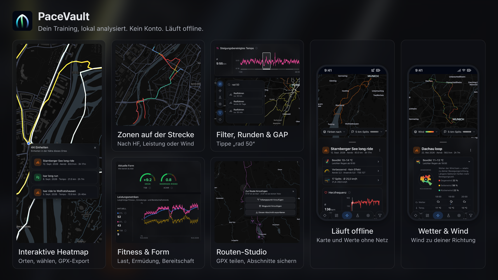

# PaceVault

A local-first training log for runners and cyclists, right in your browser.



**Try it: <https://pacevault.web.app>** — no sign-up. Install it as an app (PWA) and it works offline.

## Features

- **Interactive heatmap**: every run and ride on one map. Click a track to see the sessions recorded there.
- **Session detail**: color the route by heart rate, power, pace, speed or wind zones; step through laps and splits; grade adjusted pace (GAP) for hilly runs.
- **Weather**: historical weather for every outdoor session, with a headwind/tailwind breakdown.
- **Fitness & form**: fitness, fatigue and form over time, plus readiness and acute:chronic workload ratio (ACWR).
- **Personal bests** per sport and distance.
- **Filters in plain words**: type `ride 90 days 50 km` or `run this month` instead of clicking through menus.
- **Route studio**: import a GPX route, add split points and waypoints, and export single segments.
- English and German UI.

## Getting your data in

- `.FIT` files from any device or app that exports them
- ZIP archives of `.FIT` files, including gzipped `.fit.gz` entries (for example a Strava bulk export)
- [intervals.icu](https://intervals.icu/) sync with your own API key — new activities arrive automatically
- GPX routes into the Route studio

No data yet? Pick "Test data" on the welcome screen to explore with a generated year of training.

## Privacy & offline

There is no account and no server. Everything you import stays in your browser (IndexedDB) on your device.

PaceVault talks to only three optional services:

- [Open-Meteo](https://open-meteo.com/) — historical weather, fetched when you open a session
- [CARTO](https://carto.com/) — the map tiles
- [intervals.icu](https://intervals.icu/) — only once you add your API key

The app stays fully usable offline without them: it is an installable PWA, and map tiles you have already viewed are cached.

## Metrics & sources

How each metric is calculated, and the research behind it: [`src/packages/engine/SOURCES.md`](./src/packages/engine/SOURCES.md).

## Contributing

> requires vite+ - see: <https://viteplus.dev/guide/>, <https://viteplus.dev/guide/ide-integration#ide-integration>

1. Fork and clone the repo
2. `vp install && vp dev`
3. Create a branch: `git checkout -b feat/my-thing`
4. Read `CLAUDE.md` for architecture rules before writing code
5. Run the full verification suite before opening a PR:

   ```bash
   vp check                # fmt + lint + typecheck
   vp test -- --run        # unit & integration tests
   vp exec playwright test # e2e tests
   vp build                # production build
   ```

6. Open a PR against `main`

### Debugging a crash report

"Report bug" issues contain the minified stack and the build commit. Source maps ship with every build, so a local rebuild resolves the stack:

1. `git checkout <commit>` from the report
2. Put the real `VITE_CARTO_API_KEY` in `.env.local`, then `vp build`
3. Compare chunk names in the stack (e.g. `index-D4f.js`) with `dist/assets/` — matching names mean the build is byte-identical
4. Resolve the frames with the `.map` files in `dist/assets/`, by hand or by loading the build in DevTools

### Regenerating the README banner

```bash
vp run readme:banner                # German (default) → docs/readme/de_banner.png
vp run readme:banner --locale en    # English → docs/readme/en_banner.png
```

Loads the demo data in Playwright with a frozen clock, captures each tile in that locale (`scripts/readme/capture.readme.ts`) and renders `docs/readme/<locale>_banner.png` from `scripts/readme/banner/`; banner texts per locale live in `scripts/readme/tiles.ts`. It runs the full Chromium build in headless mode on the GPU, so glass surfaces render as on a real device. It needs network access for the map tiles; set `VITE_CARTO_API_KEY` in `.env.local` if you have one. Raw tile shots land in `scripts/readme/out/<locale>/` (gitignored). The script is not part of the e2e suite.
