# Workbench flows

The `item*` skills, the `item-worker` agent, the hooks and the board as sequence diagrams, one per flow. The rules behind each step are in the skills (`.claude/skills/item*/SKILL.md`); this file only shows who talks to whom and in which order. The owner's view is `GUIDE.md`, the technical reference `README.md`.

| Participant    | What it is                                                                                           |
| -------------- | ---------------------------------------------------------------------------------------------------- |
| **Owner**      | You: answers questions, sets `ready` and `done`, commits, reviews                                    |
| **Claude**     | The main session, running one stage skill (`item-backlog`, `-explore`, `-plan`, …)                   |
| **Worker**     | An `item-worker` subagent for one task; never sees the chat, never talks to the owner, no git writes |
| **Hooks**      | `statusGuard.ts`, `workerGitGuard.ts` (before a tool call), `indexHook.ts` (after an edit)           |
| **Item files** | `tools/workbench/backlog/<item>/`: `plan.md`, `tech.md`, `mockup/`, `research/`, `review/`           |
| **Board**      | `vp run workbench` on `http://localhost:4321`: shows, moves, ticks, answers and deletes              |

## 1. Lifecycle at a glance

Who moves an item between statuses. Dashed boxes are the owner's gates.

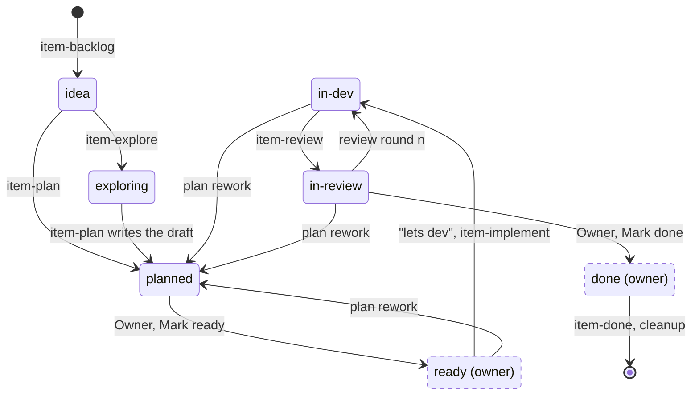

## 2. Routing: `/item`

The router only reads `status:` and `next:` and hands over; it holds no process rules.

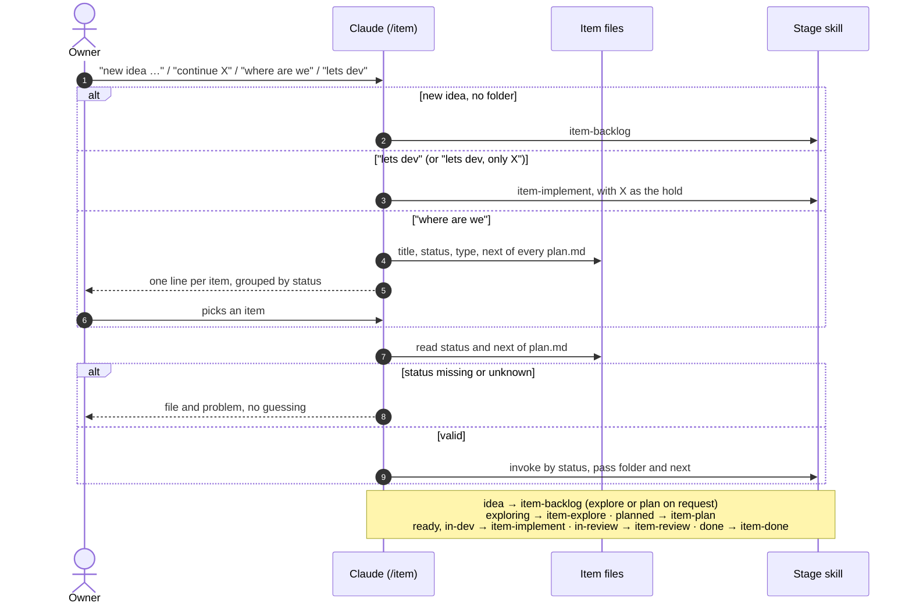

## 3. Guardrails on every tool call

Runs under every flow below, for Claude and for workers alike. A blocked step is an owner step, never retried another way.

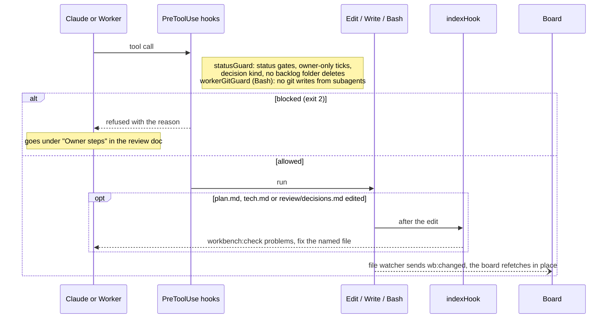

## 4. Capture an idea: `item-backlog`

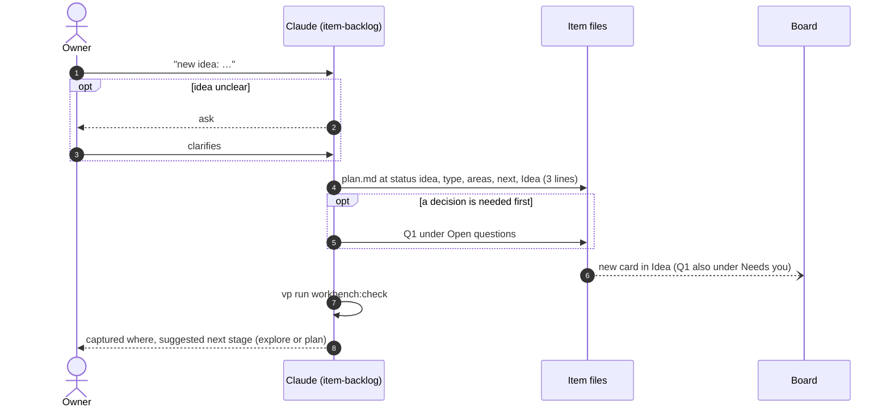

## 5. Explore a UI change: `item-explore`

Research and the mockup run in workers; every decision stays with the owner.

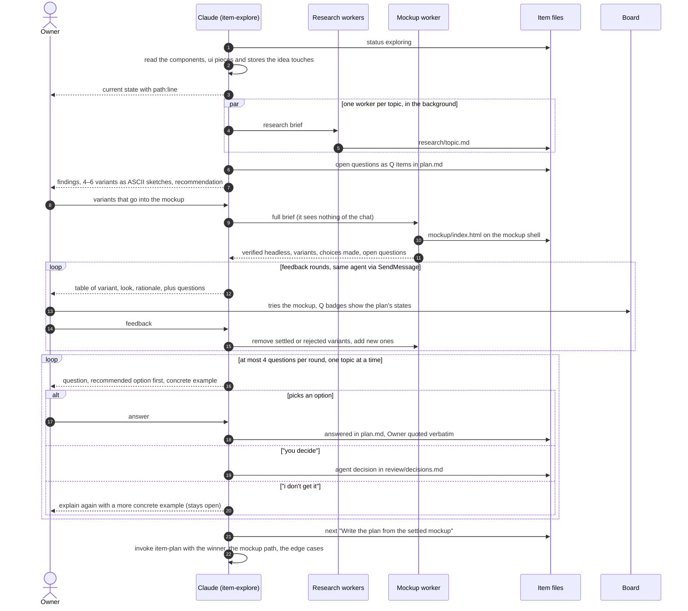

## 6. Plan and Q&A: `item-plan`

Ends in a plan without open questions. The owner sets `ready`, commits and writes "lets dev".

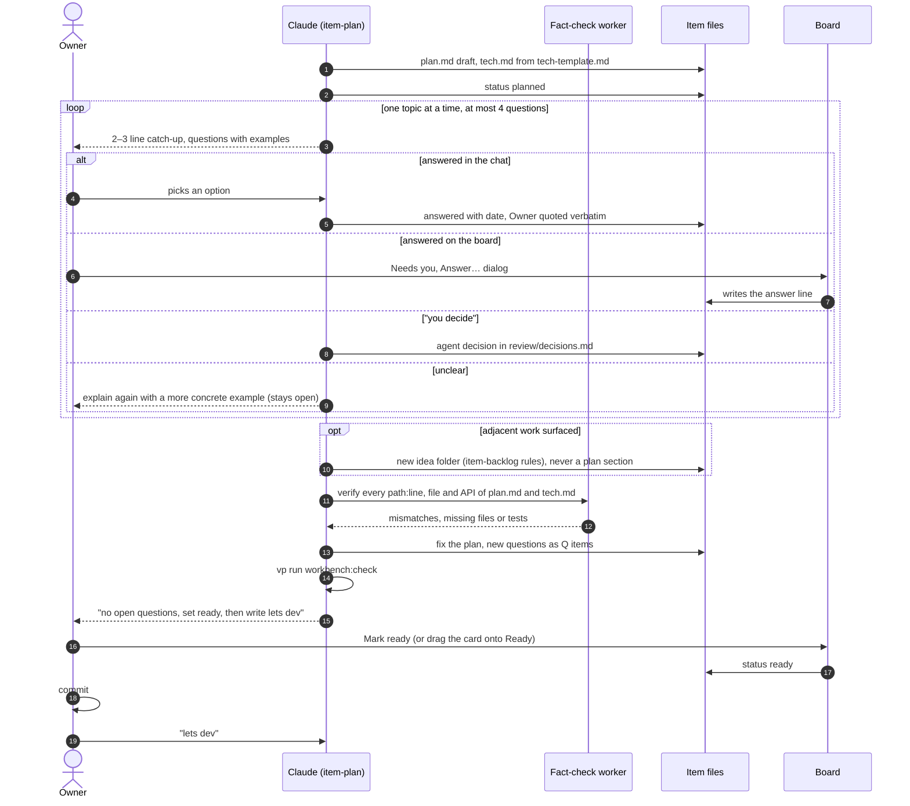

## 7. Implement: `item-implement`

After "lets dev" every `ready` plan is built back to back; nothing stops to ask.

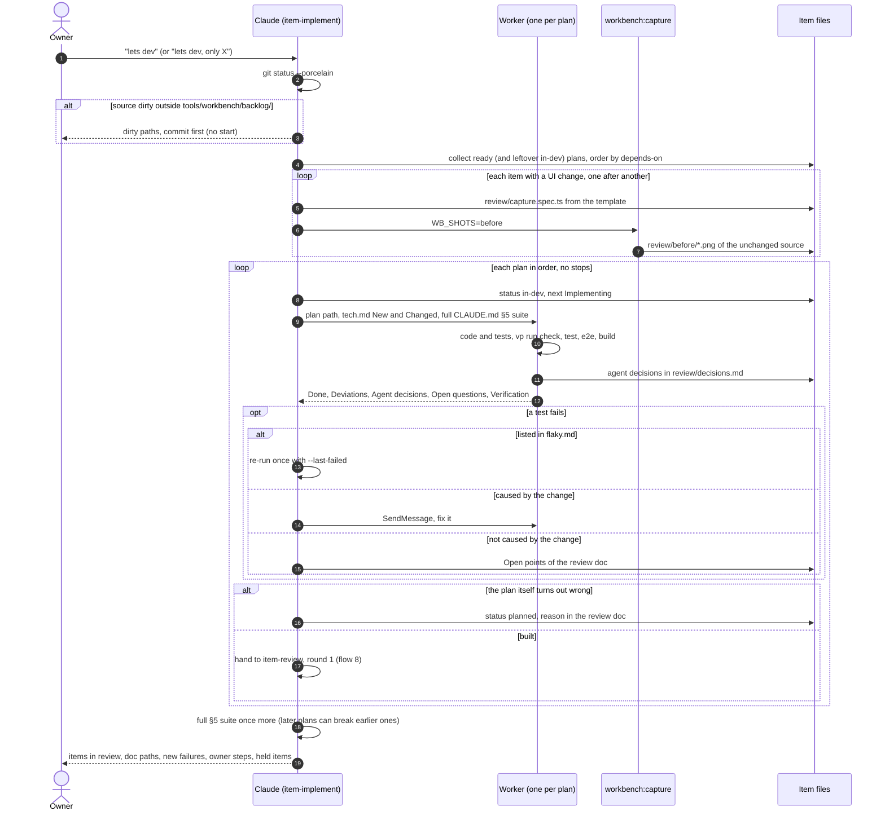

## 8. Review round 1: `item-review`

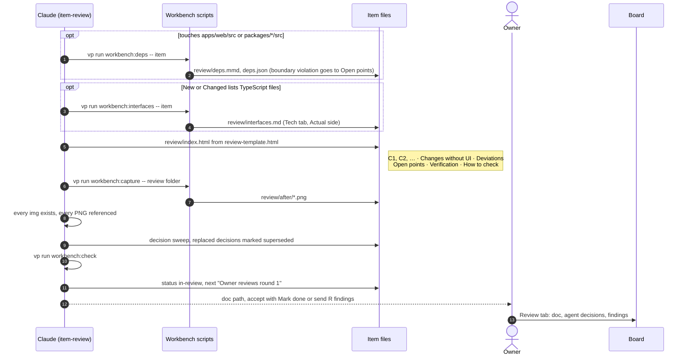

## 9. Review round n: R-labelled findings

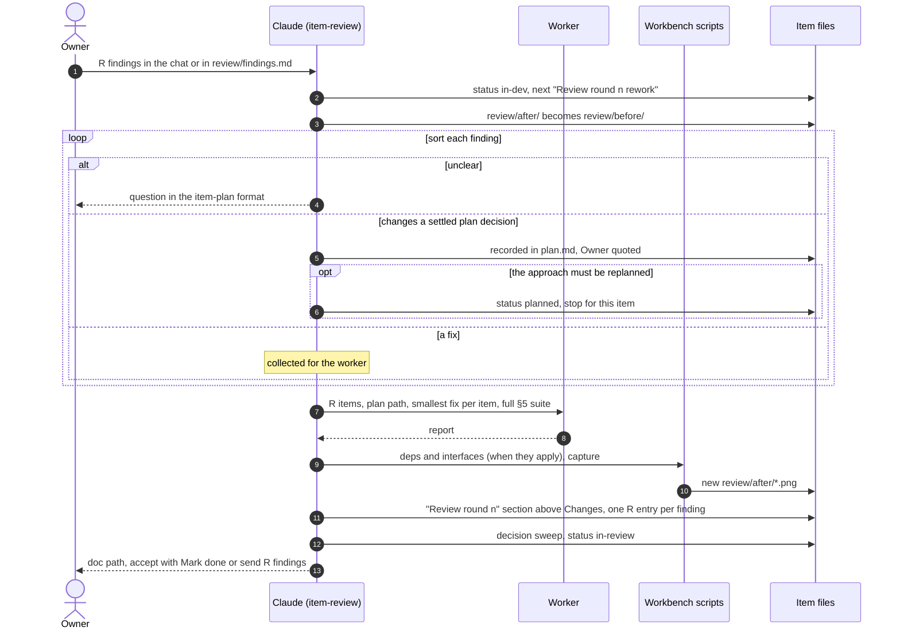

## 10. Accept and clean up: `item-done`

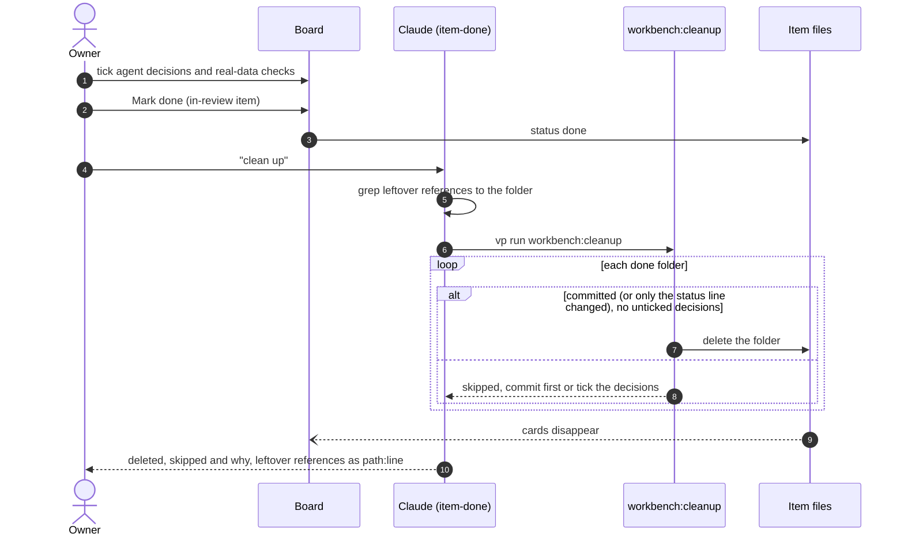

## 11. A write from the board

Every tick, answer, drag or delete on the board. The board never commits.

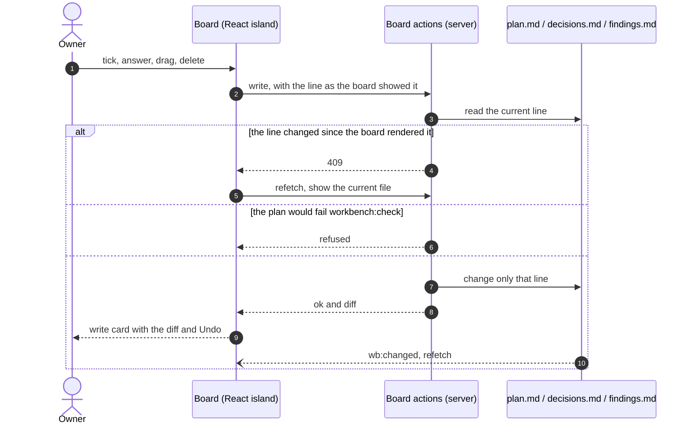
