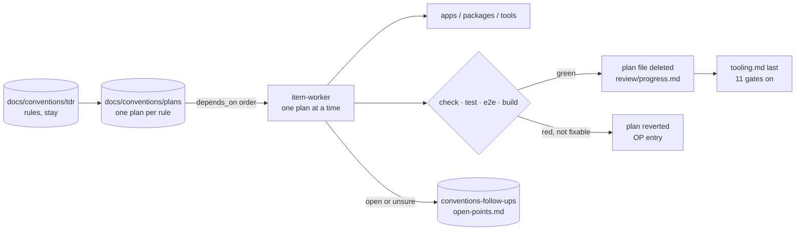
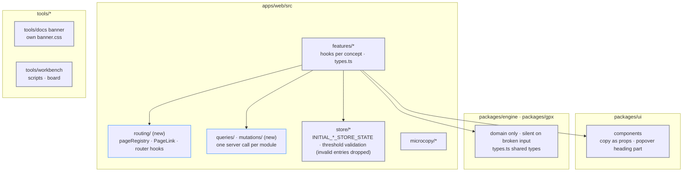

# Conventions migration: tech

## Data flow



## Modules



## Files

### New

- `apps/web/src/routing/`: page registry, `PageLink`, `usePageRouting` / `useRouterParam` / `useRouterQuery` (navigation-through-router-hooks)
- `apps/web/src/queries/`: one React Query read per module (one-server-call-per-hook-module, effects-are-rare)
- `apps/web/src/mutations/`: one React Query write per module
- `apps/web/tests/testUtils/`: `renderWithProviders` / `renderHookWithProviders` with the `strict` option (render-through-provider-helpers, Q16)
- `apps/web/tests/testUtils/defined.ts`: guard helper that replaces unsafe casts in specs (tooling item 9, Q17)
- `packages/ui/src/components/ResponsivePopoverHeading.tsx`: popover heading kit part (ui-primitives item 8, Q18; moved to `pvResponsivePopover/` later)
- `tools/workbench/scripts/boundaries.ts`: engine-purity gate run by `vp run check` (tooling item 11, Q13)
- `tools/workbench/scripts/themeTokens.ts`: theme-token gate (tooling item 12, Q13)
- `tools/workbench/tests/scripts/themeTokens.spec.ts`: spec for the theme-token gate

### Changed

- `apps/web/src/`: every rule the TDRs govern for the app
- `apps/web/tests/`: specs mirror the source tree, factories, matcher vocabulary, no unsafe casts (Q17)
- `apps/web/e2e/`: selectors and specs touched by `PageLink` and accessible names
- `packages/engine/`: shared types in `types.ts` (Q7), presentation moved out (no throws, Q26)
- `packages/gpx/`: file format only, `// Sources:` headers (Q8, Q9)
- `packages/ui/`: copy as props (Q5), popover heading part (Q18), no variant resolvers (Q4, Q25)
- `packages/testing/`: `createMockSessionRecord` defaults `{ timestamp: 0 }` (Q15)
- `packages/i18n/`: message keys
- `tools/docs/`: banner tokens in an own `banner.css` (Q3), `BANNER_LOCALE` (Q14)
- `tools/workbench/scripts/`: hooks and scripts
- `tools/workbench/site/`: board components and hooks
- `vite.config.ts`: lint gates (tooling.md)
- `package.json`: `vp run check` runs the engine-purity and theme-token gates (Q13)
- `CLAUDE.md`: § 2 example (Q12) and the verification commands at line 76 (tooling item 11)
- `docs/conventions/plans/`: emptied and removed

## Interfaces

```ts
// apps/web/src/routing/PageLink.tsx
export const PageLink: FC<PageLinkProps>; // native <a>, href from the page registry, plain left click routes

// apps/web/tests/testUtils/render.ts
export const renderHookWithProviders: <T>(hook: () => T, options?: { strict?: boolean }) => RenderHookResult<T, unknown>;
```
