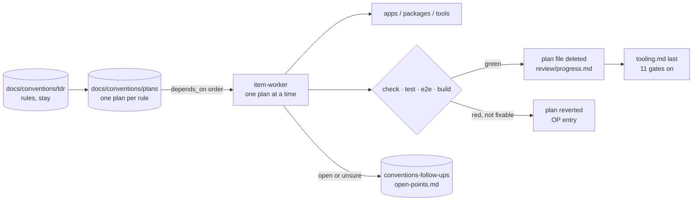
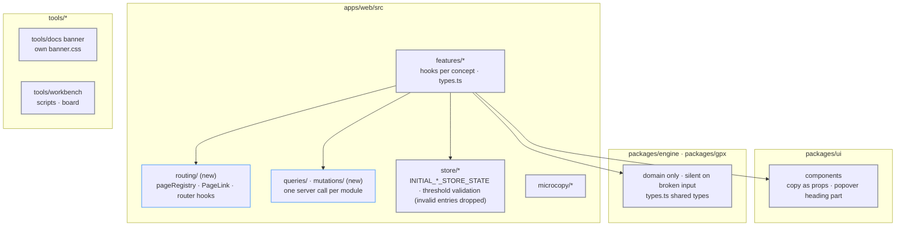

# Conventions migration: tech

## Data flow



## Modules



## Files

### New

- `apps/web/src/routing/`: page registry, `PageLink`, `usePageRouting` / `useRouterParam` / `useRouterQuery` (navigation-through-router-hooks)
- `apps/web/src/queries/`: one React Query read per module (one-server-call-per-hook-module, effects-are-rare)
- `apps/web/src/mutations/`: one React Query write per module
- `apps/web/tests/testUtils/`: `renderWithProviders` / `renderHookWithProviders` with the `strict` option (render-through-provider-helpers, Q16)
- `apps/web/tests/testUtils/defined.ts`: guard helper that replaces unsafe casts in specs (tooling item 9, Q17)
- `packages/ui/src/components/ResponsivePopoverHeading.tsx`: popover heading kit part (ui-primitives item 8, Q18; moved to `pvResponsivePopover/` later)
- `tools/workbench/scripts/boundaries.ts`: engine-purity gate run by `vp run check` (tooling item 11, Q13)
- `tools/workbench/scripts/themeTokens.ts`: theme-token gate (tooling item 12, Q13)
- `tools/workbench/tests/scripts/themeTokens.spec.ts`: spec for the theme-token gate
- `apps/web/src/components/metricLabel/`: round 2, `MetricLabel` entry `index.tsx`, `ExplanationBody`, `explanations`
- `apps/web/src/components/importProgress/`: round 2, `ImportProgress` entry `index.tsx` and its parts
- `apps/web/src/components/importProgress/importOverlayTiming.ts`: `MIN_OPEN_MS` out of `useHeldReprocess.ts` (round 2 plan 2 item 5, created in the group folder)
- `apps/web/src/components/settings/thresholdFieldErrors.ts`: `fieldErrorFor` out of `useThresholdsForm.ts` (round 2 plan 2 item 5; created in `features/settings/`, moved with the folder)
- `apps/web/src/components/settings/links.ts`: `GITHUB_URL` out of `AboutSection.tsx` (round 2 plan 2 item 6; created in `features/settings/`, moved with the folder)
- `packages/ui/src/lib/mediaQueries.ts`: `DESKTOP_MEDIA_QUERY`, `FINE_POINTER_QUERY` out of `useDevice.ts` (round 2 plan 2 item 5)
- `packages/ui/src/components/pvBottomSheet/types.ts`: `SheetAboveMotion` (round 2 plan 2 item 6)
- `tools/workbench/site/src/app/panelTabs.ts`: `tabFor` out of `usePanelState.ts` (round 2 plan 2 item 5)
- `tools/workbench/site/src/lib/boardChangedContract.ts`: the board's HMR payload contract (round 2 plan 2 item 7)
- `apps/web/src/components/errors/`: round 2, the two error fallbacks and their parts (no entry)
- `apps/web/src/components/mapBackground/`: round 2, the map feature with entry `index.tsx` → `MapBackground` (Q32)
- `apps/web/src/components/dashboard/index.tsx`: round 2 entry `Dashboard`
- `apps/web/src/components/sessions/index.tsx`: round 2 entry `Sessions`
- `apps/web/src/components/sessions/session/index.tsx`: round 2 entry `Session`
- `apps/web/src/components/trips/index.tsx`: round 2 entry `Trips`
- `apps/web/src/components/studio/index.tsx`: round 2 entry `Studio`
- `apps/web/src/components/labs/index.tsx`: round 2 entry `Labs`
- `apps/web/src/components/settings/index.tsx`: round 2 entry `Settings`
- `apps/web/src/components/CLAUDE.md`: moved from `apps/web/src/features/CLAUDE.md`, rewritten for the component layout
- `apps/web/src/lib/api/`: intervals.icu and Open-Meteo clients, `fetchResponse`, `intervalsSync`, `intervalsImport` (Q31)
- `apps/web/src/lib/storage/`: IndexedDB, codec, guarded storage, storage breakdown, `persistentStorage`, `createIngestBatcher`
- `apps/web/src/lib/analysis/`: session analysis (`movingTime`, `sessionStress`, `laps`, `moreStats`, `thresholdsAt`), `records`, `gpsTrack`, `webLock`, `reprocessSessions`, `recomputeTrainingLoad` (Q31); `sessionTerrain` goes to `components/charts/` instead (Q35)
- `apps/web/src/lib/filtering/`: merged `filters.ts`, `timeRange`, `loadAxis`, `dashboardVolume`, `weekKey`
- `apps/web/src/lib/colors/`: zone colours, colour modes, speed scale, chart theme
- `apps/web/src/lib/format/`: `formatters`, `snackbar`
- `apps/web/src/lib/workers/`: GPS and personal-bests workers with their contracts (Q31)
- `apps/web/src/lib/demo/`: `demoRecords`, `previewDrawIn`, `seededRandom`, `demoSchedule`, `demoRoutes.json` (Q31)
- `apps/web/src/store/hooks/useSessionReprocessingActive.ts`: moved from the sessions feature (Q31)
- `apps/web/src/queries/queryClient.ts`: moved from `lib/`
- `apps/web/src/routing/labsTab.ts`: moved from `lib/`
- `tools/workbench/scripts/colocation.ts`: colocation gate (no `lib/` module one feature alone imports), run by `boundaries.ts`
- `tools/workbench/tests/scripts/colocation.spec.ts`: spec for the colocation gate

### Changed

- `apps/web/src/`: every rule the TDRs govern for the app
- `apps/web/tests/`: specs mirror the source tree, factories, matcher vocabulary, no unsafe casts (Q17)
- `apps/web/e2e/`: selectors and specs touched by `PageLink` and accessible names
- `packages/engine/`: shared types in `types.ts` (Q7), presentation moved out (no throws, Q26)
- `packages/gpx/`: file format only, `// Sources:` headers (Q8, Q9)
- `packages/ui/`: copy as props (Q5), popover heading part (Q18), no variant resolvers (Q4, Q25)
- `packages/testing/`: `createMockSessionRecord` defaults `{ timestamp: 0 }` (Q15)
- `packages/i18n/`: message keys
- `tools/docs/`: banner tokens in an own `banner.css` (Q3), `BANNER_LOCALE` (Q14)
- `tools/workbench/scripts/`: hooks and scripts
- `tools/workbench/site/`: board components and hooks
- `vite.config.ts`: lint gates (tooling.md)
- `package.json`: `vp run check` runs the engine-purity and theme-token gates (Q13)
- `CLAUDE.md`: § 2 example (Q12) and the verification commands at line 76 (tooling item 11)
- `apps/web/src/components/`: round 2, every feature folder plus the shared UI groups (`charts/`, `metricLabel/`, `importProgress/`, `errors/`, `layout/`) and the UI-only helpers from `lib/`
- `apps/web/src/lib/`: round 2, ten topic folders (`api/`, `storage/`, `analysis/`, `filtering/`, `colors/`, `format/`, `hooks/`, `debug/`, `workers/`, `demo/`), nothing at the root
- `apps/web/src/parsers/`: `filename`, `fingerprint`, `fitParseProfile` moved in from `lib/`
- `apps/web/src/pages/`: thin mounts of the component entries
- `apps/web/package.json`: `./demo/schedule` export points at `src/lib/demo/demoSchedule.ts`
- `apps/web/scripts/generateDemoRoutes.ts`: writes `src/lib/demo/demoRoutes.json`
- `apps/web/README.md`: `generate-demo-routes` names `src/lib/demo/demoRoutes.json`
- `apps/web/e2e/helpers/seed.ts`, `apps/web/e2e/studio.spec.ts`, `apps/web/e2e/mobile/map.spec.ts`, `apps/web/e2e/helpers/upload.ts`: relative imports of moved app modules (`lib/storage/db.ts`, `components/sessions/archive`) and `FINE_POINTER_QUERY` from `@pacevault/ui/lib/mediaQueries.ts`
- `apps/web/src/queries/sessions/useSessionGpsTracks.ts`, `apps/web/src/queries/records/usePersonalBests.ts`: worker URLs `../../lib/workers/…`
- `apps/web/vitest.config.ts`: coverage include adds `src/components/**`, `src/queries/**`, `src/mutations/**` (Q33)
- `tools/workbench/.dependency-cruiser.cjs`: `state-no-components` replaces `store-no-features`
- `tools/workbench/scripts/boundaries.ts`: runs the colocation check after the boundary rules
- `tools/workbench/scripts/deps.ts`: `BOUNDARY_RULES`, layers for `components/<feature>` and the shared UI groups
- `tools/workbench/scripts/themeTokens.ts`: allowlist path `components/mapBackground/map-attribution.css`
- `tools/workbench/shared/tech-template.md`: example paths under `src/components/`
- `tools/workbench/tests/scripts/deps.spec.ts`, `changedFiles.spec.ts`, `techFile.spec.ts`: fixture paths under `src/components/`, `layerOf` cases
- `tools/workbench/shared/review-template.html`: example paths under `src/components/` and `src/lib/analysis/`
- `tools/workbench/CLAUDE.md`: names the `state-no-components` rule and the colocation check
- `tools/workbench/README.md`: `scripts/` row names both checks
- `CLAUDE.md` (root): round 2, `:10` components, `:34` app homes, `:57` pointer to `apps/web/src/components/CLAUDE.md`
- `apps/web/CLAUDE.md`: component layout and `lib/` topic folders, `:4` map style and intervals paths
- `packages/engine/SOURCES.md`: `:32` `lib/analysis/gpsTrack.ts`, `:77` app homes
- `apps/web/src/store/CLAUDE.md`: `lib/storage/guardedSessionsStorage.ts`
- `apps/web/tests/CLAUDE.md`: mirror example under `lib/format/`
- `packages/engine/CLAUDE.md`: app paths under `src/components/`
- `.claude/agents/item-worker.md`: app paths and surfaces (OP-77)
- `.claude/skills/item-explore/references/mockup-prompt.md`: kit and app paths (OP-77)
- `docs/conventions/tdr/helpers-split-by-reachability.md`: colocation rule R8, `lib/` topic folders in R7 (round 2 plan 5)
- `docs/conventions/tdr/hook-directory-placement.md`: hooks in `components/<feature>/hooks/`, chart hooks out of `lib/hooks/`
- `docs/conventions/tdr/formatting-through-intl-namespace.md`: `toFixed` clause R9 (round 2 plan 1), final paths
- `docs/conventions/tdr/signature-parameter-shape.md`: R6 exception for query/mutation fetchers (round 2 plan 1)
- `docs/conventions/tdr/ui-primitives-from-react-ui.md`: the five hand-built controls as an accepted exception (round 2 plan 1)
- `docs/conventions/tdr/styled-api-over-sx.md`: R10 exception for static `style` on shared geometry (Q34), final paths
- `docs/conventions/tdr/`: every other TDR that names a moved `features/` or `lib/` path or a symbol round 2 renamed (`activeSeconds`, `DATE_FORMATS`/`NUMBER_FORMATS`, `PAGE_PATTERNS`/`PAGE_TO_URL`) (round 2 plan 5 item 6)
- `docs/conventions/CLAUDE.md`: index regenerated from the TDRs
- `docs/conventions/plans/`: emptied and removed

Removed in round 2: `apps/web/src/features/` and `apps/web/tests/features/` (moved to `components/` and `lib/`), `docs/conventions/tdr/classes-are-server-side-only.md` and `docs/conventions/tdr/server-class-role-suffixes.md` (deleted, R3).

## Interfaces

```ts
// apps/web/src/routing/PageLink.tsx
export const PageLink: FC<PageLinkProps>; // native <a>, href from the page registry, plain left click routes

// apps/web/tests/testUtils/render.ts
export const renderHookWithProviders: <T>(hook: () => T, options?: { strict?: boolean }) => RenderHookResult<T, unknown>;
```
