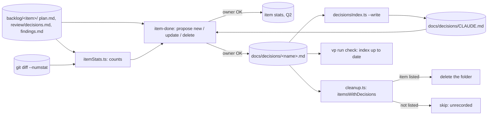
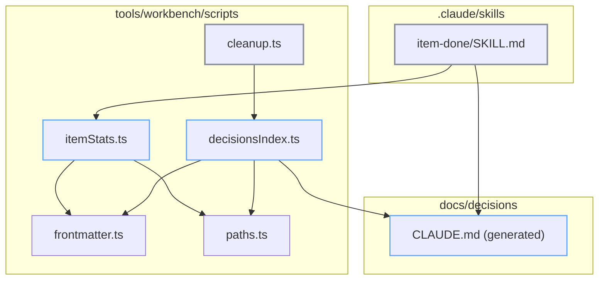

# Item history: tech

## Data flow



## Modules



## Files

### New

- `tools/workbench/scripts/decisionsIndex.ts`: frontmatter schema, index builder, items set, check/write entry
- `tools/workbench/tests/scripts/decisionsIndex.spec.ts`: index and items specs
- `docs/decisions/CLAUDE.md`: generated index, header only at first
- `tools/workbench/scripts/itemStats.ts`: counts an item's questions, findings, decisions, quotes, shots, research notes, words and diff
- `tools/workbench/tests/scripts/itemStats.spec.ts`: counts from a fixture folder

### Changed

- `tools/workbench/scripts/cleanup.ts`: `recorded` per item, `unrecorded` bucket and warning
- `tools/workbench/tests/scripts/cleanup.spec.ts`: new field and cases
- `tools/workbench/package.json`: `decisions`, `decisions:write`, `stats`
- `package.json`: `decisions` in `check`, `decisions:index`
- `.claude/skills/item-done/SKILL.md`: record step before cleanup
- `CLAUDE.md`: repo-map row for `docs/`, §4 pointer
- `apps/web/CLAUDE.md`: pointer line
- `tools/workbench/CLAUDE.md`: Acceptance and Dependency rules lines
- `tools/workbench/README.md`: scripts list, commands, cleanup line
- `tools/workbench/GUIDE.md`: done row
- `tools/workbench/FLOWS.md`: §10 record step and skip reason

## Interfaces

```ts
// tools/workbench/scripts/decisionsIndex.ts
export interface DecisionRecord {
  file: string;
  text: string;
}
export interface DecisionsIndex {
  index: string;
  errors: string[];
}
export const decisionsIndex: (records: DecisionRecord[]) => DecisionsIndex;
export const itemsWithDecisions: (records: DecisionRecord[]) => Set<string>;
export const decisionRecords: () => DecisionRecord[];

// tools/workbench/scripts/itemStats.ts
export interface ItemStats {
  item: string;
  createdOn: string;
  doneOn: string;
  days: number;
  questions: { total: number; answered: number };
  findings: { total: number; fixed: number; declined: number; rounds: number };
  decisions: { confirmed: number; superseded: number; open: number };
  ownerQuotes: number;
  screenshots: { before: number; after: number; megabytes: number };
  reviewEntries: number;
  researchNotes: number;
  words: number;
  code: { insertions: number; deletions: number; files: number };
  backlogLines: number;
}
export const itemStats: (input: { folder: ItemFolderFiles; diff: string; doneOn: string }) => ItemStats;

// tools/workbench/scripts/cleanup.ts
type CleanupItem = { folder: string; status: string | undefined; openDecisions: number; recorded: boolean };
type Deletions = { remove: string[]; skip: string[]; undecided: string[]; unrecorded: string[] };
export const selectDeletions: (input: {
  items: CleanupItem[];
  changes: ReadonlyMap<string, FolderChanges>;
}) => Deletions;
```
