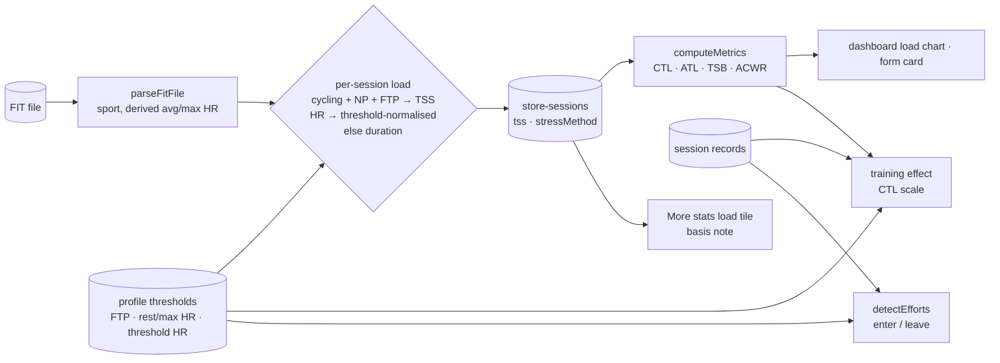
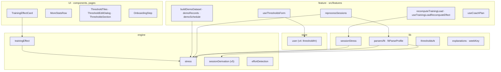
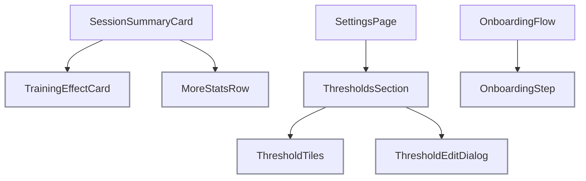

# Load and effort model: tech

## Data flow



## Modules



## Components



## Files

### Changed

- `packages/engine/src/stress.ts`: sport rule, threshold ratio helper, clamp
- `packages/engine/src/trainingEffect.ts`: shared threshold ratio
- `packages/engine/src/sessionDerivation.ts`: HR derivation, version 5
- `packages/engine/src/effortDetection.ts`: `leave` level
- `packages/engine/SOURCES.md`: threshold ratio, effort levels
- `packages/engine/tests/stress.spec.ts`
- `packages/engine/tests/trainingEffect.spec.ts`
- `packages/engine/tests/effortDetection.spec.ts`
- `apps/web/src/parsers/fit.ts`: derive before stress, sport, summary ?? derived HR
- `apps/web/src/lib/fitParseProfile.ts`: threshold HR
- `apps/web/src/lib/sessionStress.ts`: sport, signature with threshold HR
- `apps/web/src/lib/thresholdsAt.ts`: threshold HR
- `apps/web/src/types/index.ts`: `thresholds.thresholdHr`
- `apps/web/src/store/user.ts`: key, schema, save branch, version 4 + migrate
- `apps/web/src/features/sessions/reprocessSessions.ts`: derived HR in `recomputeFromRecords`
- `apps/web/src/features/sessions/recomputeTrainingLoad.ts`: sport; per Q6 the records path for HR changes
- `apps/web/src/features/sessions/hooks/useTrainingLoadRecomputeEffect.ts`: HR part vs the applied signature, FTP part as today
- `apps/web/src/store/sessions.ts`: persisted applied HR signature, version 4 + migrate
- `apps/web/src/features/demo/loadDemoData.ts`: records the applied HR signature
- `apps/web/tests/store/sessionsStore.integration.test.ts`
- `apps/web/src/features/sessions/session/TrainingEffectCard.tsx`: threshold HR; basis per Q9
- `apps/web/src/features/sessions/session/MoreStatsRow.tsx`: basis note
- `apps/web/src/lib/moreStats.ts`: whether threshold HR is estimated at the session date
- `apps/web/src/features/settings/hooks/useThresholdsForm.ts`: threshold HR field
- `apps/web/src/features/settings/ThresholdTiles.tsx`: threshold HR tile
- `apps/web/src/features/settings/thresholdIcons.ts`
- `apps/web/src/features/settings/ThresholdEditDialog.tsx`
- `apps/web/src/features/settings/ThresholdsSection.tsx`
- `apps/web/src/features/onboarding/OnboardingStep.tsx`: threshold HR field per Q8
- `apps/web/src/features/demo/demoRecords.ts`: FTP at the date, climb cap
- `apps/web/src/features/demo/demoSchedule.ts`: sweet spot 0.92
- `apps/web/src/features/demo/buildDemoDataset.ts`: threshold HR, `calculateSessionStress` at the session date, shared HR derivation
- `apps/web/src/lib/explanations.ts`: drop `sports`
- `apps/web/src/lib/weekKey.ts`: plan key per Q14
- `apps/web/src/lib/railFormat.ts`: export `MISSING`
- `apps/web/src/features/labs/hooks/useCoachPlan.ts`
- `packages/i18n/messages/en.json`
- `packages/i18n/messages/de.json`
- `apps/web/tests/lib/explanations.spec.ts`
- `apps/web/tests/store/userStore.integration.test.ts`
- `apps/web/tests/parsers/fitThresholds.integration.test.ts`
- `apps/web/tests/features/sessions/reprocessSessions.integration.test.ts`
- `apps/web/tests/features/sessions/recomputeTrainingLoad.integration.test.ts`
- `apps/web/tests/features/demo/buildDemoDataset.spec.ts`
- `apps/web/tests/packages/engine/stressPipeline.integration.test.ts`
- `apps/web/tests/parsers/fitRequiredFields.spec.ts`
- `apps/web/tests/lib/sessionFitness.spec.ts`
- `apps/web/tests/lib/weekKey.spec.ts`
- `apps/web/src/features/dashboard/ReadinessGauge.tsx`: `--` without data
- `apps/web/src/features/dashboard/ACWRGauge.tsx`: `--` without data, no stray `contextLabel`
- `apps/web/src/features/studio/markers/StudioMarkerDialog.tsx`: from-split field guard
- `packages/ui/src/components/Dialog.tsx`: desktop height cap keeps the footer visible
- `CLAUDE.md`: exports rule names `@pacevault/web`
- `apps/web/tests/CLAUDE.md`: pointer to the GPX snapshot exception
- `apps/web/e2e/dashboard.spec.ts`
- `apps/web/e2e/studio.spec.ts`
- `apps/web/e2e/helpers/seed.ts`
- `apps/web/e2e/labs.spec.ts`
- `apps/web/e2e/onboarding.spec.ts`

## Interfaces

```ts
// packages/engine/src/stress.ts
export interface StressThresholds {
  restHr: number;
  maxHr: number;
  gender: Gender;
  ftp?: number;
  thresholdHr?: number;
}
/** (thresholdHr − rest) / (max − rest), 0.88 without a threshold HR. */
export const thresholdHrRatio: (
  thresholds: Pick<StressThresholds, 'restHr' | 'maxHr' | 'thresholdHr'>,
) => number;
/** Records-based: TSS for cycling with NP + FTP, else per-record HR, else average HR, else duration. */
export const calculateSessionStress: (
  sport: Sport,
  records: SessionRecord[],
  summary: StressSummary,
  thresholds: StressThresholds,
) => SessionStress;
/** Metadata path (FTP changes): TSS for cycling only. */
export const calculateSummaryStress: (
  sport: Sport,
  summary: StressSummary,
  thresholds: StressThresholds,
) => SessionStress;

// packages/engine/src/trainingEffect.ts
export const calculateTrainingEffect: (
  records: SessionRecord[],
  thresholds: Pick<StressThresholds, 'restHr' | 'maxHr' | 'gender' | 'thresholdHr'>,
  ctl: number,
) => { aerobic: number; anaerobic: number } | undefined;

// packages/engine/src/sessionDerivation.ts
export const SESSION_DERIVATION_VERSION = 5;
export interface RecordDerivedFields {
  distance?: number;
  avgPower?: number;
  avgCadence?: number;
  maxSpeed?: number;
  gap?: number;
  avgHr?: number;
  maxHr?: number;
}

// packages/engine/src/effortDetection.ts
export interface EffortSignalDefaults {
  minWork: number;
  enter: number;
  leave: number;
  steady: number;
}

// apps/web/src/lib/thresholdsAt.ts
export interface ResolvedThresholds {
  restHr: number;
  maxHr: number;
  thresholdHr?: number;
  ftp?: number;
  thresholdPace?: number;
  weightKg?: number;
  age?: number;
  gender: Gender;
}

// apps/web/src/lib/sessionStress.ts
type StressInputs = Pick<TrainingSession, 'date' | 'duration' | 'avgHr' | 'normalizedPower' | 'sport'>;
```
