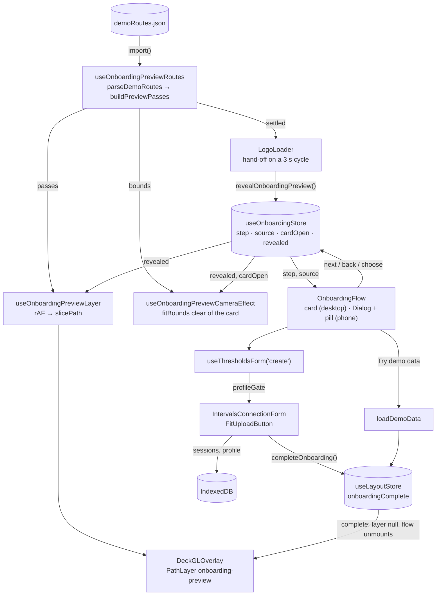
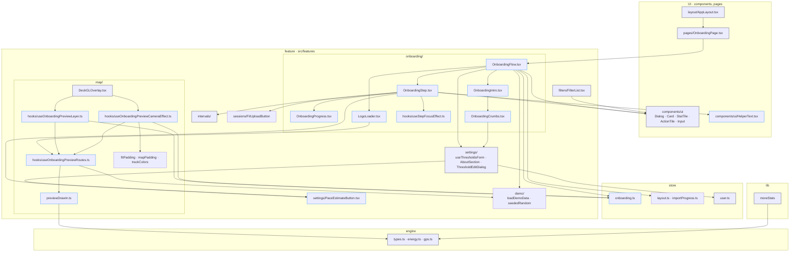
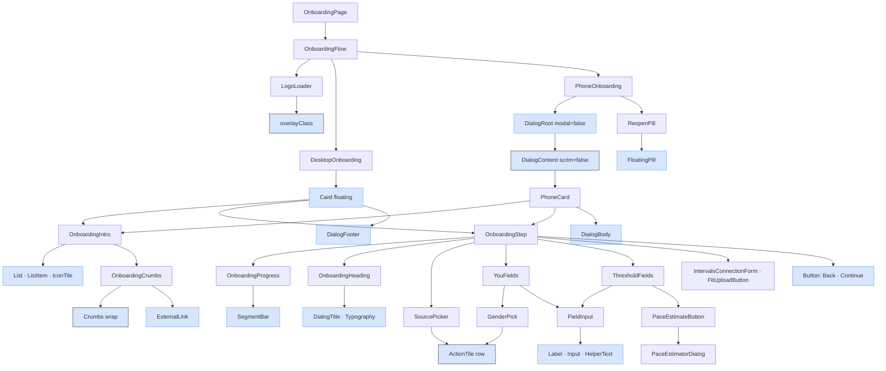

# Onboarding redesign: tech

## Data flow

The preview query feeds the loader, the layer and the camera; the flow store drives the screens; the import or the demo ends onboarding through `useLayoutStore`.



## Modules



### New

- `src/store/onboarding.ts`: flow state, not persisted
- `src/features/onboarding/OnboardingFlow.tsx`
- `src/features/onboarding/OnboardingIntro.tsx`
- `src/features/onboarding/OnboardingStep.tsx`
- `src/features/onboarding/OnboardingProgress.tsx`
- `src/features/onboarding/OnboardingCrumbs.tsx`
- `src/features/onboarding/LogoLoader.tsx`
- `src/features/onboarding/hooks/useStepFocusEffect.ts`: review round 3
- `src/features/map/previewDrawIn.ts`: pure, decode + jitter + slice
- `src/features/map/hooks/useOnboardingPreviewRoutes.ts`
- `src/features/map/hooks/useOnboardingPreviewLayer.ts`
- `src/features/map/hooks/useOnboardingPreviewCameraEffect.ts`
- `src/components/ui/HelperText.tsx`: review round 3
- `src/features/settings/PaceEstimateButton.tsx`: review round 2

### Changed

- `src/pages/OnboardingPage.tsx`: thin container
- `src/components/layout/AppLayout.tsx`
- `src/components/ui/Dialog.tsx`: `scrim`
- `src/components/ui/Card.tsx`: `overlayClass`
- `src/components/ui/StatTile.tsx`: `Crumbs wrap`
- `src/components/ui/ActionTile.tsx`: row only
- `src/components/ui/Input.tsx`: helper line through `HelperText`
- `src/features/map/DeckGLOverlay.tsx`: calls the preview layer and camera hooks
- `src/features/settings/hooks/useThresholdsForm.ts`
- `src/features/settings/AboutSection.tsx`: `GITHUB_URL`
- `src/features/settings/ThresholdsSection.tsx`
- `src/features/settings/ThresholdTiles.tsx`
- `src/features/settings/ThresholdEditDialog.tsx`: `PaceEstimateButton`
- `src/features/intervals/IntervalsConnectionForm.tsx`
- `src/features/filters/FilterList.tsx`
- `src/store/user.ts`: binary gender
- `src/packages/engine/types.ts`: binary gender
- `src/packages/engine/energy.ts`: binary gender
- `src/lib/moreStats.ts`: binary gender

## Interfaces

```ts
// src/store/onboarding.ts
export type OnboardingStep = 'intro' | 'source' | 'you' | 'thresholds' | 'import';
export type OnboardingSource = 'intervals' | 'fit';
export const ONBOARDING_FLOW_STEPS: OnboardingStep[];

interface OnboardingState {
  step: OnboardingStep;
  source: OnboardingSource | null;
  onboardingCardOpen: boolean;
  onboardingPreviewRevealed: boolean;
  startOnboardingSetup: () => void;
  chooseOnboardingSource: (source: OnboardingSource) => void;
  nextOnboardingStep: () => void;
  previousOnboardingStep: () => void;
  setOnboardingCardOpen: (open: boolean) => void;
  revealOnboardingPreview: () => void;
}
export const useOnboardingStore: UseBoundStore<StoreApi<OnboardingState>>;
export const onboardingProgressOf: (step: OnboardingStep) => number;
```

```ts
// src/features/map/previewDrawIn.ts (pure)
export interface PreviewPass {
  sport: Sport;
  path: [number, number][]; // [lng, lat]
  cumulative: number[]; // metres at each point
  length: number;
  start: number; // ms after the reveal
  duration: number;
}
export interface PreviewPasses {
  passes: PreviewPass[];
  bounds: GPSBounds | null;
}

export const buildPreviewPasses: (routes: PreviewRoute[]) => PreviewPasses;
export const previewDrawInEnd: (passes: PreviewPass[]) => number;
export const slicePath: (pass: PreviewPass, elapsedMs: number) => [number, number][];
```

```ts
// src/features/map/hooks/
export const useOnboardingPreviewRoutes: () => UseQueryResult<PreviewPasses>;
export const useOnboardingPreviewLayer: () => PathLayer<PreviewSlice> | null;
export const useOnboardingPreviewCameraEffect: () => void;

// src/features/onboarding/hooks/useStepFocusEffect.ts
export const useStepFocusEffect: (
  step: OnboardingStep,
  headingRef: RefObject<HTMLElement | null>,
) => void;
```

```ts
// src/components/ui/Dialog.tsx
interface DialogContentProps extends DialogPrimitive.DialogContentProps {
  /** false: no overlay, and outside taps never close it (pair with `DialogRoot modal={false}`). */
  scrim?: boolean;
}

// src/components/ui/Card.tsx
export const overlayClass = 'bg-surface-base/85 backdrop-blur-sm';

// src/components/ui/StatTile.tsx
export const Crumbs: (props: { items: ReactNode[]; wrap?: boolean }) => JSX.Element;

// src/components/ui/HelperText.tsx
export const HelperText: (props: {
  id?: string;
  error?: boolean;
  children?: ReactNode;
}) => JSX.Element;
```

```ts
// src/features/onboarding/OnboardingStep.tsx
export type OnboardingShell = 'card' | 'dialog';
export const OnboardingHeading: (props: {
  shell: OnboardingShell;
  title: string;
  subtitle: string;
}) => JSX.Element;
export const OnboardingStep: (props: {
  shell: OnboardingShell;
  thresholds: ThresholdsForm;
  onDemo: () => void;
}) => JSX.Element;

// src/features/settings/PaceEstimateButton.tsx
export const PaceEstimateButton: (props: { onClick: () => void }) => JSX.Element;
```

```ts
// src/packages/engine/types.ts
export type Gender = 'male' | 'female';

// src/features/settings/hooks/useThresholdsForm.ts
export type FormField = TextField | 'gender';
interface FormValues {
  gender: Gender | null;
  // … birthYear, restHr, maxHr, weight, ftp, thresholdPace as strings
}
export interface ProfileGate {
  ready: boolean;
  save: () => void;
}
```

## Components

The render tree from the page down; shared pieces from `src/components/ui/` are marked (`ui` reused, `uimod` reused and changed by this feature).


