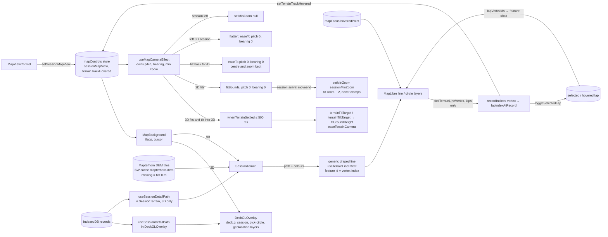
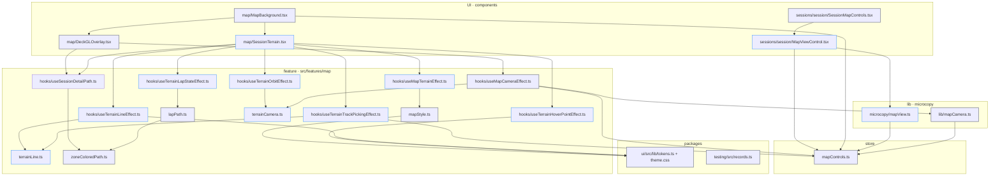
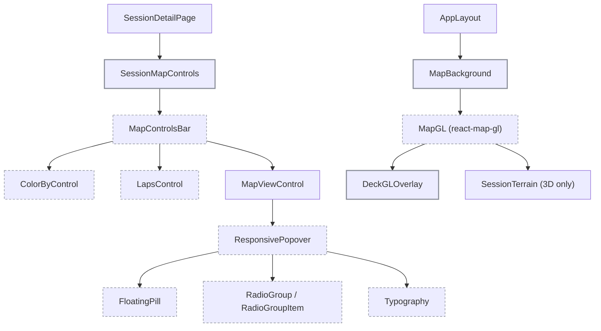

# 3D session map: tech

## Data flow



## Modules



## Components



## Files

### New

- `apps/web/src/microcopy/mapView.ts`: label and description maps of the Map view control
- `apps/web/src/features/sessions/session/MapViewControl.tsx`: Map view pill and popover
- `apps/web/src/features/map/terrainLine.ts`: generic draped line: segment features (id = vertex index), width expression, pick → vertex index
- `apps/web/src/features/map/terrainCamera.ts`: DEM settle wait, 3D fit target, ground height, per-frame ease, interpolation, median elevation, orbit constants
- `apps/web/src/features/map/SessionTerrain.tsx`: loads the detail path and mounts the 3D terrain and session layers inside `MapGL`
- `apps/web/src/features/map/hooks/useMapTerrainEffect.ts`: DEM sources, hillshade, `setTerrain`
- `apps/web/src/features/map/hooks/useTerrainLineEffect.ts`: generic: one draped line source with line, hover and selection layers (feature state), dim paint
- `apps/web/src/features/map/hooks/useTerrainLapStateEffect.ts`: session add-on: lap `sel` / `hov` feature state
- `apps/web/src/features/map/hooks/useTerrainHoverPointEffect.ts`: chart cursor dot as a circle layer
- `apps/web/src/features/map/hooks/useTerrainTrackPickingEffect.ts`: track hover state, lap hover and lap click on the draped track
- `apps/web/src/features/map/hooks/useTerrainOrbitEffect.ts`: Shift/Ctrl/Cmd + drag orbit
- `apps/web/tests/features/map/terrainLine.spec.ts`: segments, nearest vertex, width expression
- `apps/web/tests/features/map/terrainCamera.spec.ts`: interpolation, median elevation, ground height, DEM settle (stub map)

### Changed

- `apps/web/src/store/mapControls.ts`: `MAP_VIEWS` / `MapView`, `sessionMapView`, `terrainTrackHovered`, setters, resets
- `packages/ui/src/theme.css`: map paint tokens
- `packages/ui/src/lib/tokens.ts`: map paint tokens
- `packages/testing/src/records.ts`: `createMockSessionRecord`
- `apps/web/src/features/sessions/session/SessionMapControls.tsx`: Map view pill
- `apps/web/src/features/map/MapBackground.tsx`: flags per view, `pitchWithRotate`, cursor, `SessionTerrain`
- `apps/web/src/features/map/DeckGLOverlay.tsx`: `terrain` prop, no session, pick-circle or geolocation layers in 3D
- `apps/web/src/features/map/hooks/useMapCameraEffect.ts`: options parameter, flat 2D fits, 3D fits, `tilt`, `flatten`, zoom-out limit set and clear
- `apps/web/src/lib/mapCamera.ts`: view on the session target, `tilt` and `flatten` fits, `sessionMinZoom`
- `apps/web/src/features/map/mapStyle.ts`: Mapterhorn source, attribution, hillshade paint
- `apps/web/src/features/map/zoneColoredPath.ts`: `DetailPath.elevations`
- `apps/web/src/features/map/lapPath.ts`: slices `elevations`, `lapVertexIds`
- `apps/web/vite.config.ts`: `mapterhorn-dem` runtime cache
- `packages/i18n/messages/en.json`: Map view keys
- `packages/i18n/messages/de.json`: Map view keys
- `apps/web/CLAUDE.md`: Mapterhorn as fourth external service
- `apps/web/tests/store/mapControls.spec.ts`: view reset on session open/close
- `apps/web/tests/lib/mapCamera.spec.ts`: `tilt` and `flatten` fits, neither blocked, `sessionMinZoom`
- `apps/web/tests/features/map/lapPath.spec.ts`: `lapSubPath` slices `elevations`, `lapVertexIds`
- `apps/web/tests/features/map/zoneColoredPath.spec.ts`: `elevations` keeps 0 m, missing is `null`
- `apps/web/e2e/map.spec.ts`: session map view describe

## Interfaces

```ts
// apps/web/src/store/mapControls.ts (added)
export const MAP_VIEWS: readonly ['2d', '3d'];
export type MapView = (typeof MAP_VIEWS)[number];
sessionMapView: MapView;
setSessionMapView: (view: MapView) => void;
terrainTrackHovered: boolean;
setTerrainTrackHovered: (hovered: boolean) => void;

// packages/ui/src/lib/tokens.ts (added)
mapShadow: '#000000';
mapHighlight: '#ffffff';
mapHillshadeHighlight: '#ffffff1a';
mapDotStroke: '#00000050';

// packages/testing/src/records.ts
export const createMockSessionRecord: (overrides?: Partial<SessionRecord>) => SessionRecord;

// apps/web/src/microcopy/mapView.ts
export const LABEL_BY_MAP_VIEW: Record<MapView, () => string>;
export const DESCRIPTION_BY_MAP_VIEW: Record<MapView, () => string>;

// apps/web/src/features/map/zoneColoredPath.ts
export interface DetailPath {
  path: [number, number][];
  recordIndices: number[];
  color: Color | Color[];
  elevations: Array<number | null>;
}

// apps/web/src/features/map/terrainLine.ts (generic, no session knowledge)
type LineColor = [number, number, number, number];
export const buildTerrainLineSegments: (input: { path: [number, number][]; colors: LineColor | LineColor[]; dimFactor: number }) => FeatureCollection<LineString, { c: string; d: string }>;
export const terrainLineWidthExpression: (input: { metres: number; minPixels: number; latitude: number }) => ExpressionSpecification;
export const nearestLineVertex: (input: { hits: Array<{ vertex: number; screen: [number, number] }>; point: [number, number] }) => number | undefined;
export const pickTerrainLineVertex: (input: { map: MapLibreMap; layerId: string; point: [number, number]; radius: number }) => number | undefined;

// apps/web/src/features/map/hooks/useTerrainLineEffect.ts
export const useTerrainLineEffect: (input: {
  id: string;
  path: [number, number][];
  colors: LineColor | LineColor[];
  width: { metres: number; minPixels: number; casingMinPixels: number; selectedMinPixels: number };
  dimmed: boolean;
}) => void;

// apps/web/src/features/map/lapPath.ts (added)
export const lapVertexIds: (input: { detailPath: DetailPath; span: LapSpan }) => number[];

// apps/web/src/features/map/terrainCamera.ts
export const DEM_SETTLE_TIMEOUT_MS = 500;
export const LAP_FIT_DURATION_MS = 800;
export const SESSION_FIT_DURATION_MS = 1200;
export const TILT_DURATION_MS = 800;
export const ENTRY_PITCH = 30;
export const PITCHED_ZOOM_OUT = 0.4;
export interface TerrainCamera { center: [number, number]; zoom: number; pitch: number; bearing: number; elevation: number }
export const interpolateTerrainCamera: (input: { from: TerrainCamera; to: TerrainCamera; progress: number }) => TerrainCamera;
export const medianElevation: (elevations: Array<number | null>) => number | undefined;
export const fitGroundHeight: (input: { settled: boolean; terrain: number | null; median: number | undefined; current: number }) => number;
export const whenTerrainSettled: (input: { map: MapLibreMap; timeout: number }) => Promise<boolean>;
export const terrainFitTarget: (input: { map: MapLibreMap; bounds: GPSBounds; pitch: number; bearing: number; padding: PaddingOptions; maxZoom?: number; median: number | undefined; settled: boolean }) => TerrainCamera | null;
export const terrainTiltTarget: (input: { map: MapLibreMap; pitch: number; median: number | undefined; settled: boolean }) => TerrainCamera;
export const easeTerrainCamera: (input: { map: MapLibreMap; target: TerrainCamera; duration: number; onEnd?: () => void }) => () => void;

// apps/web/src/lib/mapCamera.ts
export type MapCameraTarget =
  | { kind: 'overview' }
  | { kind: 'session'; sessionId: string; lapIndex: number | null; view: MapView }
  | { kind: 'trip'; tripKey: string }
  | { kind: 'studioTab' }
  | { kind: 'studioRoute'; routeId: string };
export type MapCameraFit = 'overview' | 'session' | 'lap' | 'lapClose' | 'tilt' | 'flatten' | 'trip' | 'studio';
export const sessionMinZoom: (input: { fitZoom: number; currentZoom: number }) => number;

// apps/web/src/features/map/hooks/useMapCameraEffect.ts
export const useMapCameraEffect: (input: {
  gpsData: SessionGPS[] | null;
  tracks: MapTrack[];
  lapPath: DetailPath | null;
  sessionPath: DetailPath | null;
  mapLoaded: boolean;
}) => void;

// apps/web/src/features/map/SessionTerrain.tsx (no props: reads the stores, loads its own detail path)
export const SessionTerrain: FC;
```
