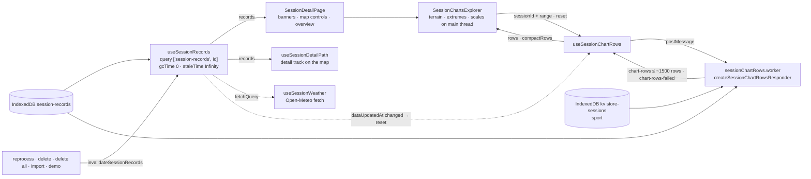
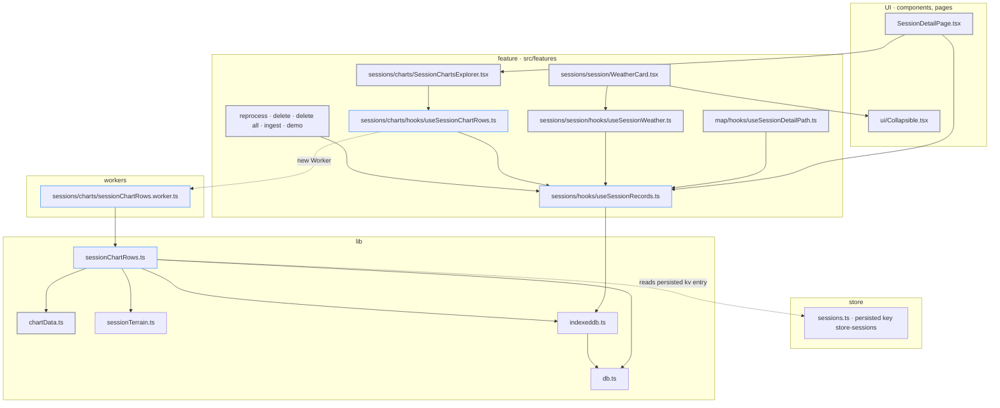
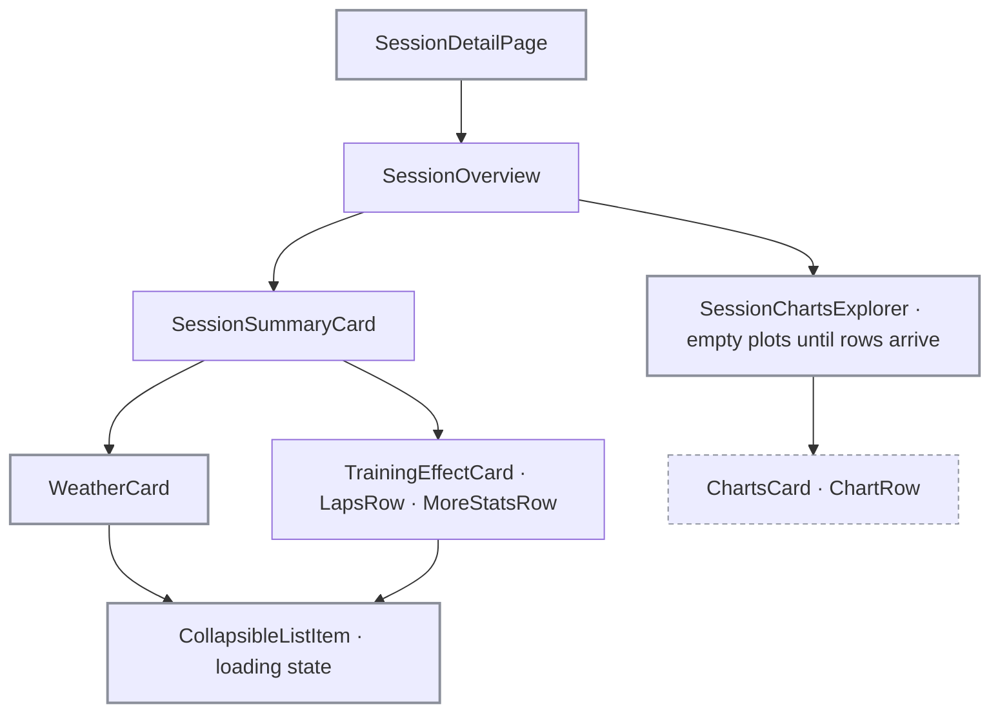

# Session detail reload: tech

## Data flow



## Modules



### New

- `src/features/sessions/hooks/useSessionRecords.ts`: records query, options and invalidation
- `src/lib/sessionChartRows.ts`: worker logic (`createSessionChartRowsResponder`), message types, cache per session id, Zod read of `sport` from `store-sessions`
- `src/features/sessions/charts/sessionChartRows.worker.ts`: thin `self.onmessage` around the responder
- `src/features/sessions/charts/hooks/useSessionChartRows.ts`: worker lifecycle, request ids, reset on `dataUpdatedAt` change

### Changed

- `src/pages/SessionDetailPage.tsx`: records from the query instead of state + `getSessionRecords`
- `src/features/map/hooks/useSessionDetailPath.ts`: ref, state and effect replaced by `useSessionRecords(targetId, hasDetailedRecords)`
- `src/features/sessions/session/hooks/useSessionWeather.ts`: `ctx.client.fetchQuery(sessionRecordsQueryOptions(id))`
- `src/features/sessions/charts/SessionChartsExplorer.tsx`: `useSessionChartRows(props.session, zoomRange)` replaces the two row memos; loading branch
- `src/lib/chartData.ts`: exports `SessionChartRows`
- `src/components/ui/Collapsible.tsx`: loading state on `CollapsibleListItem`
- `src/features/sessions/session/WeatherCard.tsx`: uses that loading state instead of the 52 px block
- `src/features/sessions/hooks/useSessionReprocessingEffect.ts`: `invalidateSessionRecords`
- `src/features/sessions/session/DeleteSessionDialog.tsx`: `invalidateSessionRecords`
- `src/features/settings/DeleteAllDataDialog.tsx`: `invalidateSessionRecords`
- `src/features/sessions/createIngestBatcher.ts`: `invalidateSessionRecords`
- `src/features/demo/loadDemoData.ts`: `invalidateSessionRecords`

## Interfaces

```ts
// src/features/sessions/hooks/useSessionRecords.ts (planned; names from the plan, types inferred)
export const sessionRecordsQueryOptions: (sessionId: string) => UseQueryOptions<SessionRecord[]>; // queryKey ['session-records', id], gcTime 0, staleTime Infinity, structuralSharing false, retry false
export const useSessionRecords: (
  sessionId: string,
  enabled: boolean,
) => UseQueryResult<SessionRecord[]>;
export const invalidateSessionRecords: (queryClient: QueryClient) => Promise<void>;
```

```ts
// src/lib/sessionChartRows.ts (planned; message types from the plan, responder shape not fixed)
export type ChartRowsRequest =
  | {
      type: 'chart-rows';
      requestId: number;
      sessionId: string;
      range: { from: number; to: number } | null;
    }
  | { type: 'reset' };
export type ChartRowsResponse =
  | { type: 'chart-rows'; requestId: number; rows: SessionChartRows }
  | { type: 'chart-rows-failed'; requestId: number };
export const createSessionChartRowsResponder: () => (
  request: ChartRowsRequest,
) => Promise<ChartRowsResponse | undefined>;
```

```ts
// src/features/sessions/charts/hooks/useSessionChartRows.ts (planned; return shape not fixed by the plan)
export const useSessionChartRows: (
  session: TrainingSession,
  zoomRange: { from: number; to: number } | null,
) => { rows: SessionChartRows | undefined; compactRows: SessionChartRows | undefined };
```

```ts
// src/lib/chartData.ts (existing function; type export planned)
export type SessionChartRows = ReturnType<typeof buildSessionChartRows>;
export const buildSessionChartRows: (records: SessionRecord[], options: SessionChartRowOptions) => …;
// SessionChartRowOptions: { isRunning: boolean; terrain: SessionTerrain; range?: { from: number; to: number } }
```

```ts
// src/lib/sessionTerrain.ts (existing, used by the worker)
export const buildSessionTerrain: (sport: Sport, records: SessionRecord[]) => SessionTerrain;
```

```ts
// src/lib/indexeddb.ts (existing, queryFn and worker read)
export const getSessionRecords: (sessionId: string) => Promise<SessionRecord[]>;
```

## Components


