# Segments: tech

## Data flow

```mermaid
flowchart LR
  subgraph CREATE["create (session detail)"]
    zoom[charts drag-zoom range, desktop] --> pill[Save as segment pill]
    menu[session ⋯ Use as reference segment] --> draft
    pill --> draft[segmentDraft: records slice → cuts, engine facts, display polyline + bounds, suggested name]
    draft --> dialog[SegmentNameDialog + similarSegment hint]
  end
  dialog -->|Save| save[useSaveSegment]
  save -->|1 addSegment| store[(store-segments in kv: id, name, sport, source session + cuts, facts, polyline, bounds)]
  save -->|2 open| page
  sessions[(sessions store: ids, sport, derivationVersion)] --> key[query key: matcher version, segment ids, sessions key per sport]
  store --> key
  key --> passesQ[useSegmentPasses query, enabled on tab, session detail, segment page]
  passesQ -->|postMessage segments + sessions| worker[segments.worker.ts → segmentMatching.ts]
  worker -->|cached entry, same matcher version| cache[(IDB segment-passes: checked session keys + passes)]
  worker -->|sessions not yet checked| gps[(session-gps bounds: bbox prefilter)]
  worker -->|source session records, sliced at the cuts| reference[engine segmentReference: 10 m points]
  gps --> records[(session-records of source + candidates)]
  reference --> match
  records --> match[engine segmentTrack + segmentPasses: corridor match, best pass per session]
  match -->|put| cache
  match -->|done message| passesQ
  store --> join[useSegments: store ⨝ passes → MatchedSegment]
  passesQ --> join
  join --> tab[Segments tab + filters view]
  join --> row[session Segments row]
  join --> page[segment page: Finding passes… / passes]
  join --> map[map: tab tracks fade, pick popup, page segment]
  import[import / delete / reprocess] -->|changes sessions key| key
  rename[⋯ Rename] --> store
  del[⋯ Delete] -->|delete passes entry, removeSegment| store
  delSession[session Delete dialog: warns with the segment names] -->|removeSegmentsOfSession + delete their passes entries| store
  delAll[Delete all data] -->|clearAll + clear IDB stores| store
```



## Modules

```mermaid
flowchart TB
  subgraph UI["UI · pages, routing"]
    SegmentDetailPage:::new
    AppRoutes:::mod
    pageRegistry:::mod
    dashboardTab:::new
    useRouteMatch:::mod
  end
  subgraph FEAT["feature · src/components/segments"]
    segIndex["index.tsx, SegmentDetail, SegmentHeader, SegmentActionsMenu, DeleteSegmentDialog, SegmentPassesNote"]:::new
    creation["SaveSegmentPill, SegmentNameDialog, segmentCreation.ts"]:::new
    SegmentsTab:::new
    PassTimesRow:::new
    SegmentChartsExplorer:::new
    segmentPasses:::new
    segmentFilter:::new
    segHooks["hooks/useSegments, useSegmentDetail, useFilteredSegments, useSessionSegments, useSaveSegment, useSimilarSegment, useSessionReferenceSegment, useSegmentPassSelection, useScatterWindow"]:::new
  end
  subgraph SESS["feature · sessions, dashboard, mapBackground"]
    SegmentsRow:::new
    SessionActionsMenu:::mod
    DeleteSessionDialog:::mod
    SessionChartsExplorer:::mod
    railRange:::mod
    Dashboard["dashboard/index.tsx"]:::mod
    mapSeg["useSegmentMapTracks, useSegmentLayers, useSegmentsPickPopup"]:::new
    mapMod["trackPicking, useTrackLayers, useMapInteraction, camera hooks"]:::mod
  end
  subgraph IO["queries, mutations"]
    useSegmentPasses:::new
    deleteMut["useDeleteSegmentMutation"]:::new
    deleteSessionMut["useDeleteSessionMutation"]:::mod
  end
  subgraph STORE["store"]
    segmentsStore["segments (persisted)"]:::new
    segmentFocus:::new
    mapControls:::mod
    filtersStore["filters (read only)"]
  end
  subgraph LIB["lib"]
    db["storage/db.ts"]:::mod
    worker["workers/segments.worker.ts"]:::new
    contract["workers/segmentsContract.ts"]:::new
    matching["analysis/segmentMatching.ts"]:::new
    gpsTrack["analysis/gpsTrack.ts"]
    debug["debug/segmentMetrics.ts"]:::new
    microcopy["microcopy/segments.ts"]:::new
    formatters["format/formatters.ts"]:::mod
  end
  subgraph ENG["engine"]
    segments["segments.ts (matcher)"]:::new
    geodesy["geodesy.ts, bounds.ts"]
  end
  subgraph KIT["packages/ui"]
    PvActionItem:::new
    PvZoomResetPill:::mod
    kitMods["PvStatRail, PvCollapsibleListItem, scroll fade x, --color-best"]:::mod
  end
  SegmentDetailPage --> segIndex
  segIndex --> segHooks
  SegmentsTab --> segHooks
  SegmentsRow --> segHooks
  SessionChartsExplorer --> creation
  SessionChartsExplorer --> PvZoomResetPill
  SessionActionsMenu --> creation
  creation --> railRange
  creation --> segments
  creation --> gpsTrack
  segIndex --> deleteMut
  deleteMut --> db
  segIndex --> segmentsStore
  DeleteSessionDialog --> segmentsStore
  DeleteSessionDialog --> deleteSessionMut
  DeleteSessionDialog --> microcopy
  deleteSessionMut --> db
  microcopy --> formatters
  creation --> segmentsStore
  segHooks --> useSegmentPasses
  segHooks --> segmentsStore
  useSegmentPasses --> worker
  useSegmentPasses --> contract
  useSegmentPasses --> debug
  worker --> matching
  matching --> segments
  matching --> db
  segments --> geodesy
  db --> contract
  SegmentsTab --> segmentFilter
  segmentFilter --> filtersStore
  mapSeg --> segHooks
  mapSeg --> segmentFocus
  mapMod --> mapSeg
  SegmentsRow --> mapControls
  PassTimesRow --> segmentPasses
  segIndex --> microcopy
  SegmentsTab --> PvActionItem
  classDef new stroke:#60a5fa,stroke-width:1.5px
  classDef mod stroke:#8b8f9a,stroke-width:2px
```



## Components

```mermaid
flowchart TB
  DashboardPage --> Dashboard["Dashboard (PvTabs: Dashboard │ Segments)"]:::uimod
  Dashboard --> SegmentsTab
  SegmentsTab --> SegmentsEmpty["SegmentsEmpty (SplinePointer, No segments yet + how-to)"]
  SegmentsTab --> VirtualItemList
  VirtualItemList --> SegmentItemA["SegmentItem md (name, facts · passes, short date)"]
  SegmentItemA --> PvActionItem:::ui
  MapBackground["mapBackground/index.tsx"]:::uimod --> SegmentsPickPopup
  SegmentsPickPopup --> SegmentItemP["SegmentItem md"]

  SessionDetailPage --> Session["sessions/session/index.tsx"]
  Session --> SessionActionsMenu:::uimod
  SessionActionsMenu --> PvActionsMenu:::ui
  SessionActionsMenu --> NameDialogR["SegmentNameDialog (create, whole session, similar hint)"]
  SessionActionsMenu --> DeleteSessionDialog["DeleteSessionDialog (segment warning)"]:::uimod
  Session --> SessionSummaryCard:::uimod
  SessionSummaryCard --> SegmentsRow
  SegmentsRow --> PvCollapsibleListItem:::uimod
  SegmentsRow --> SessionSegmentList
  SessionSegmentList --> SegmentItemB["SegmentItem sm (name, time · rank)"]
  Session --> SessionChartsExplorer:::uimod
  SessionChartsExplorer --> PvZoomResetPill:::uimod
  PvZoomResetPill --> SaveSegmentPill
  SaveSegmentPill --> PvFloatingPill:::ui
  SaveSegmentPill --> NameDialogC["SegmentNameDialog (create, chart range, similar hint)"]
  NameDialogC --> PvDialog:::ui

  SegmentDetailPage --> Segments["segments/index.tsx"]
  Segments --> SegmentDetailSkeleton
  Segments --> SegmentDetail
  SegmentDetail --> SegmentPeek
  SegmentDetail --> SegmentHeader["SegmentHeader (name, facts, Finding passes…)"]
  SegmentHeader --> SegmentActionsMenu
  SegmentActionsMenu --> NameDialogE["SegmentNameDialog (rename)"]
  SegmentActionsMenu --> DeleteSegmentDialog
  SegmentDetail --> PvPageGrid:::ui
  PvPageGrid --> PassTimesRow
  PassTimesRow --> SegmentPassesNote["SegmentPassesNote (1 pass · only this session so far)"]
  PassTimesRow --> PassScatter
  PassTimesRow --> PassItem
  PassItem --> PassGapSpark
  PassItem --> BestCrown
  PvPageGrid --> SegmentChartsExplorer
  SegmentChartsExplorer --> PvChartsCard:::ui
  SegmentChartsExplorer --> SegmentExplorerLegend
  SegmentChartsExplorer --> SegmentChannelChart
  SegmentChartsExplorer --> SegmentChannelRail
  SegmentChannelRail --> PvStatRail:::uimod
  classDef ui stroke:#8b8f9a,stroke-dasharray:4 3
  classDef uimod stroke:#8b8f9a,stroke-width:2px
```



## Files

### New

- `packages/engine/src/segments.ts`: matcher only: 10 m resampling (`segmentTrack`, `segmentReference`), reference facts, `matchTolerances` (corridor 30 m, coverage 95 %, end tolerance 1 % of the length within 50–200 m), corridor match with direction, coverage and end tolerance, best pass per session (`segmentPasses`)
- `packages/engine/tests/segments.spec.ts`: matcher cases on series factories
- `packages/engine/tests/segments.perf.spec.ts`: one reference against many synthetic sessions, time logged under a generous bound
- `packages/testing/src/segments.ts`: `createMockSegmentPass`, `createMockSegmentTrack`, `createMockSegmentReferencePoint` (engine input, built at match time)
- `packages/ui/src/components/pvActionItem/PvActionItem.tsx`: one-button item, sizes `md` | `sm`
- `packages/ui/tests/hooks/useScrollFadeEffect.spec.ts`: x axis sets `data-fade-left` / `data-fade-right`
- `apps/web/src/store/segments.ts`: persisted `store-segments` (version 1): the user's segments (name, sport, source session with its cuts, facts, display polyline, bounds), `addSegment`, `renameSegment`, `removeSegment`, `removeSegmentsOfSession`, `clearAll`
- `apps/web/src/store/segmentFocus.ts`: hovered segment, hovered pass, pass and best markers (not persisted)
- `apps/web/src/lib/workers/segmentsContract.ts`: zod schemas for the match input (source session and cuts), the passes cache entry and the worker messages, `SEGMENT_MATCHER_VERSION`
- `apps/web/src/lib/workers/segments.worker.ts`: thin `self.onmessage` around `segmentMatching.ts`
- `apps/web/src/lib/analysis/segmentMatching.ts`: per segment: cache check (matcher version, source session key), drop passes of sessions that are gone, reference from the source records between the cuts, bbox prefilter on `session-gps`, records read once per run, engine match, cache write; metrics
- `apps/web/src/lib/debug/segmentMetrics.ts`: matching metrics on `window.pvSegmentMetrics` and the console behind `pv:debug:segments` (`cold` ignores the cache)
- `apps/web/src/queries/segments/useSegmentPasses.ts`: runs the worker; key = matcher version, segment ids, sessions key per sport; previous result kept while re-matching
- `apps/web/src/mutations/segments/useDeleteSegmentMutation.ts`: deletes the segment's passes entry
- `apps/web/src/routing/dashboardTab.ts`: `DashboardTab`, `resolveDashboardTab`
- `apps/web/src/pages/SegmentDetailPage.tsx`: thin page for `/segments/:id`
- `apps/web/src/microcopy/segments.ts`: count, passes, rank, show more / fewer, name suggestion, the session delete note (count + quoted names)
- `apps/web/src/lib/hooks/useDragScroll.ts`: mouse drag scrolls a horizontal container
- `apps/web/src/components/layout/VirtualItemList.tsx`: virtualized list shared by the session list and the Segments tab
- `apps/web/src/components/segments/index.tsx`: segment page entry: param, store lookup, not-found
- `apps/web/src/components/segments/SegmentDetail.tsx`: peek, header, `PvPageGrid` with the summary card and the explorer; skeletons while the passes are found
- `apps/web/src/components/segments/SegmentDetailSkeleton.tsx`: card and explorer skeletons
- `apps/web/src/components/segments/SegmentHeader.tsx`: SplinePointer tile, user name, "Running · 1.4 km · +4 m", inline "Finding passes…", ⋯
- `apps/web/src/components/segments/SegmentPeek.tsx`: phone peek with name and facts
- `apps/web/src/components/segments/SegmentActionsMenu.tsx`: ⋯ with Rename and Delete (`PvActionsMenu`, like `SessionActionsMenu`)
- `apps/web/src/components/segments/SegmentNameDialog.tsx`: `PvDialog` with a name field (prefilled, selected), facts line, in create mode the similar-segment hint with "Open segment", Cancel / Save; modes create and rename
- `apps/web/src/components/segments/DeleteSegmentDialog.tsx`: confirm like `DeleteTripDialog`; opens the Segments tab afterwards
- `apps/web/src/components/segments/SaveSegmentPill.tsx`: "Save as segment" floating pill (SplinePointer) next to Reset zoom, opens the name dialog
- `apps/web/src/components/segments/SegmentPassesNote.tsx`: "1 pass · only this session so far" (or no pass) + "New imports are checked against this segment automatically"
- `apps/web/src/components/segments/segmentCreation.ts`: draft from a record span (cuts, facts, polyline, bounds), suggested name, `similarSegment`
- `apps/web/src/components/segments/segmentsSnackbars.ts`: no GPS in the range
- `apps/web/src/components/segments/SegmentsTab.tsx`: Dashboard tab content: virtualized items, skeletons on the first match, empty state
- `apps/web/src/components/segments/SegmentsEmpty.tsx`: "No segments yet" + the shared how-to
- `apps/web/src/components/segments/SegmentItem.tsx`: SplinePointer tile in the sport colour, user name, value slot; opens the segment page
- `apps/web/src/components/segments/SegmentItemSkeleton.tsx`: item skeleton
- `apps/web/src/components/segments/SegmentsPickPopup.tsx`: map pick popup listing the segments under a click
- `apps/web/src/components/segments/BestCrown.tsx`: amber crown on the best card's corner
- `apps/web/src/components/segments/BestHighlight.tsx`: best item decoration (crown, border)
- `apps/web/src/components/segments/PassTimesRow.tsx`: Pass times row: scatter, passes, show more / fewer, single-pass note
- `apps/web/src/components/segments/PassScatter.tsx`: Recharts scatter + rolling median, horizontal scroll window
- `apps/web/src/components/segments/PassItem.tsx`: pass card (condensed `PvActionItem`)
- `apps/web/src/components/segments/PassGapSpark.tsx`: time-gap-to-best mini chart
- `apps/web/src/components/segments/segmentPasses.ts`: best, latest, ordering, rolling median, rank, window, gap series, positions, session segments in ride order
- `apps/web/src/components/segments/segmentFacts.ts`: distance and signed net elevation
- `apps/web/src/components/segments/segmentFilter.ts`: dashboard filter as a view over the matched segments (Q82)
- `apps/web/src/components/segments/hooks/useSegments.ts`: store ⨝ passes → `MatchedSegment[]`
- `apps/web/src/components/segments/hooks/useSegmentDetail.ts`: one segment by id with its passes and the finding flag
- `apps/web/src/components/segments/hooks/useFilteredSegments.ts`: `useSegments` + filters
- `apps/web/src/components/segments/hooks/useSessionSegments.ts`: the segments a session rode, with time and rank
- `apps/web/src/components/segments/hooks/useSaveSegment.ts`: `addSegment`, then the segment page; no-GPS snackbar for a `null` draft
- `apps/web/src/components/segments/hooks/useSimilarSegment.ts`: the stored segment nearly matching a draft (Q108)
- `apps/web/src/components/segments/hooks/useSessionReferenceSegment.ts`: whether the session can become or already is a reference, draft of the whole session
- `apps/web/src/components/segments/hooks/useSegmentPassSelection.ts`: selected pass (origin from `?from=`, else latest)
- `apps/web/src/components/segments/hooks/useScatterWindow.ts`: visible pass ids after scrolling settles
- `apps/web/src/components/segments/hooks/useScatterScrollEndEffect.ts`: scroll-end listener for the scatter
- `apps/web/src/components/segments/hooks/useListExpansion.ts`: show more / fewer state with the scroll-into-view on collapse
- `apps/web/src/components/segments/charts/SegmentChartsExplorer.tsx`: selected vs best per channel
- `apps/web/src/components/segments/charts/SegmentChannelChart.tsx`: one channel chart
- `apps/web/src/components/segments/charts/SegmentChannelRail.tsx`: rail with the best note (crown)
- `apps/web/src/components/segments/charts/SegmentExplorerLegend.tsx`: floating legend pill
- `apps/web/src/components/segments/charts/segmentChartRows.ts`: slice a pass's records, rows on elapsed time
- `apps/web/src/components/segments/charts/segmentChannels.ts`: channel specs
- `apps/web/src/components/segments/charts/segmentExplorerHover.ts`: hover group and markers
- `apps/web/src/components/segments/charts/hooks/useSegmentChartRows.ts`: loads the selected and best records
- `apps/web/src/components/sessions/session/SegmentsRow.tsx`: Segments row: count or "No segments yet", the how-to as the secondary line, SplinePointer icon
- `apps/web/src/components/sessions/session/SessionSegmentList.tsx`: the session's segments in ride order, 5 + show more, hover previews the stretch
- `apps/web/src/components/mapBackground/hooks/useSegmentMapTracks.ts`: whether the tab or the page drives the map, which segments, bounds
- `apps/web/src/components/mapBackground/hooks/useSegmentLayers.ts`: hovered stretch, page segment, pass and best markers
- `apps/web/src/components/mapBackground/hooks/useSegmentsPickPopup.ts`: track click on the tab → segments under it, popup also for one hit
- `apps/web/tests/store/segments.spec.ts`: add, rename, remove, removeSegmentsOfSession, clearAll, persist version 1
- `apps/web/tests/lib/analysis/segmentMatching.spec.ts`: cache hit, new session matched only, gone session dropped, matcher version, source reprocessed, reference cut from the source records, bbox prefilter, source records missing
- `apps/web/tests/lib/storage/db.segments.integration.spec.ts`: v4 → v5 keeps data, `segment-passes`, invalid entries fall back, delete by ids
- `apps/web/tests/lib/workers/segmentsContract.spec.ts`: schemas accept valid, reject invalid
- `apps/web/tests/components/segments/segmentCreation.spec.ts`: span from a zoom range, cuts, any length, suggestion, no GPS, `similarSegment`
- `apps/web/tests/components/segments/hooks/useSaveSegment.spec.ts`: store entry added, page opened, no-GPS snackbar
- `apps/web/tests/components/segments/SegmentNameDialog.spec.tsx`: prefill, Enter, blank name, similar hint with "Open segment", rename without hint
- `apps/web/tests/components/sessions/session/DeleteSessionDialog.spec.tsx`: segment note with names, cascade on Delete
- `apps/web/tests/components/segments/SegmentActionsMenu.spec.tsx`: rename, delete confirm, Segments tab afterwards
- `apps/web/tests/components/segments/segmentPasses.spec.ts`: median, rank, window, gap series, positions
- `apps/web/tests/components/segments/segmentFilter.spec.ts`: filter view
- `apps/web/tests/components/segments/PassTimesRow.spec.tsx`: collapsed list, show more / fewer, selection, single-pass note
- `apps/web/tests/components/segments/charts/segmentChartRows.spec.ts`: slicing, elapsed time, missing stays null
- `apps/web/tests/components/sessions/session/SegmentsRow.spec.tsx`: how-to line at 0 and n, item opens `/segments/<id>?from=`
- `apps/web/tests/components/sessions/session/SessionActionsMenu.spec.tsx`: "Use as reference segment" vs "Open segment", hidden without GPS
- `apps/web/tests/components/mapBackground/trackPicking.segments.spec.ts`: segments in pick bounds
- `apps/web/tests/factories/segments.ts`: `createMockSegment`, `createMockMatchedSegment`, `createMockStoredSegmentPass`, `createMockSegmentPassesEntry`
- `apps/web/tests/routing/dashboardTab.spec.ts`: tab resolution
- `apps/web/tests/routing/useRouteMatch.spec.ts`: decoded ids
- `apps/web/e2e/segments.spec.ts`: create from charts, session menu reference, rename, delete, similar hint, source session delete

### Changed

- `packages/engine/SOURCES.md`: `segments.ts` row (corridor match)
- `packages/engine/tests/metrics.ewmaAlpha.spec.ts`: follows the series factory change
- `packages/testing/src/series.ts`: GPS series along a given path (offset, reverse, speed)
- `packages/ui/src/components/pvChartsCard/PvZoomResetPill.tsx`: optional `children` rendered before the reset pill in the same sticky row
- `packages/ui/src/components/pvStatRail/types.ts`: note `icon`
- `packages/ui/src/components/pvStatRail/PvStatRail.tsx`: renders the note icon
- `packages/ui/src/components/pvCollapsibleListItem/PvCollapsibleListItem.tsx`: `defaultOpen`
- `packages/ui/src/theme.css`: `--color-best`, `scroll-fade-x`
- `packages/ui/src/lib/tokens.ts`: `best`
- `packages/ui/src/lib/scrollFade.ts`: `horizontalScrollFadeEdges`
- `packages/ui/src/hooks/useScrollFadeEffect.ts`: `options?: { axis }`
- `packages/ui/tests/lib/scrollFade.spec.ts`: left / right edges
- `packages/i18n/messages/en.json`: segment keys (no type labels)
- `packages/i18n/messages/de.json`: segment keys (no type labels)
- `apps/web/CLAUDE.md`: §1 Storage row lists `segment-passes`
- `apps/web/src/main.tsx`: rehydrates `useSegmentsStore`
- `apps/web/src/lib/storage/db.ts`: v5 with `segment-passes`, read / write / delete by ids, cleared with the rest
- `apps/web/src/lib/storage/storageBreakdown.ts`: `segment-passes` → appData
- `apps/web/src/types.ts`: `QueryResults.segmentPasses`
- `apps/web/src/lib/analysis/laps.ts`: `RecordSpan`, `recordSpanBetween`
- `apps/web/src/lib/format/formatters.ts`: short date, ordinal, signed race time, `formatList`
- `apps/web/src/lib/debug/pvDebug.ts`: `segmentMetrics` command
- `apps/web/src/routing/pageRegistry.ts`: `segmentDetail` with `from`, dashboard `tab`
- `apps/web/src/routing/AppRoutes.tsx`: segment route
- `apps/web/src/routing/urlQuery.ts`: `from`
- `apps/web/src/routing/useRouteMatch.ts`: decoded ids
- `apps/web/src/components/layout/DockTabs.tsx`: `segmentDetail` → dashboard
- `apps/web/src/components/dashboard/index.tsx`: `PvTabs` Dashboard │ Segments
- `apps/web/src/components/settings/deleteAllData.ts`: `useSegmentsStore` `clearAll`, reset the passes query
- `apps/web/src/components/sessions/SessionList.tsx`: uses `VirtualItemList`
- `apps/web/src/components/sessions/session/SessionSummaryCard.tsx`: Segments row after Laps
- `apps/web/src/components/sessions/session/SessionActionsMenu.tsx`: "Use as reference segment" / "Open segment" + name dialog
- `apps/web/src/components/sessions/session/DeleteSessionDialog.tsx`: names the session's segments in the description, removes them on Delete (Q106)
- `apps/web/src/mutations/sessions/useDeleteSessionMutation.ts`: takes `segmentIds`, deletes their passes entries with the session data
- `apps/web/src/components/sessions/charts/SessionChartsExplorer.tsx`: `SaveSegmentPill` beside Reset zoom while zoomed
- `apps/web/src/components/sessions/charts/railRange.ts`: record span of a minute range
- `apps/web/src/store/mapControls.ts`: `hoveredSegmentSpan`
- `apps/web/src/components/mapBackground/index.tsx`: segments pick popup
- `apps/web/src/components/mapBackground/DeckGLOverlay.tsx`: segment layers
- `apps/web/src/components/mapBackground/trackPicking.ts`: `segmentsInPickBounds`, `pickSegmentsAt` on stored bounds
- `apps/web/src/components/mapBackground/trackColors.ts`: `BEST_MARKER_COLOR`
- `apps/web/src/components/mapBackground/lapPath.ts`: paths from a `RecordSpan`
- `apps/web/src/components/mapBackground/mapCamera.ts`: `segment` target
- `apps/web/src/components/mapBackground/hooks/useMapCameraTarget.ts`: segment page target
- `apps/web/src/components/mapBackground/hooks/useMapCameraInputs.ts`: segment bounds
- `apps/web/src/components/mapBackground/hooks/useMapCameraEffect.ts`: fits the segment
- `apps/web/src/components/mapBackground/hooks/useMapInteraction.ts`: track click on the tab opens the segments popup
- `apps/web/src/components/mapBackground/hooks/useTrackLayers.ts`: tab fade, hover, hidden on the page
- `apps/web/src/components/mapBackground/hooks/useLapLayers.ts`: hovered segment span
- `apps/web/src/components/mapBackground/hooks/useTerrainLapStateEffect.ts`: hovered segment span in 3D
- `apps/web/e2e/helpers/seed.ts`: create `segment-passes`
- `apps/web/tests/lib/storage/db.integration.spec.ts`: version 5 with `segment-passes`
- `apps/web/tests/routing/pageRegistry.spec.ts`: new URLs
- `apps/web/tests/lib/format/formatters.spec.ts`: new modes, `formatList`
- `apps/web/tests/components/mapBackground/lapPath.spec.ts`: `RecordSpan`
- `apps/web/tests/lib/analysis/records.computePbsForSessions.spec.ts`: follows the series factory change

## Interfaces

Overview: the user's segments live only in the persisted `store-segments` (name, sport, source session with its start and end cut, facts, display polyline, bounds); no reference geometry is stored (Q106). The worker builds each reference at match time from the source session's records between the cuts. Passes are a derived cache in `segment-passes`, one entry per segment, built by the worker through the engine matcher and refreshed incrementally when the sessions change. Deleting the source session deletes its segments and their cache entries. The UI reads `MatchedSegment`s (store ⨝ passes) through `useSegments`.

```ts
// packages/engine/src/segments.ts
export const SEGMENT_SPLIT_COUNT = 24;
export interface SegmentTrackPoint {
  lat: number;
  lng: number;
  distanceMeters: number;
  timestampSec: number;
  elevationMeters: number | undefined;
}
export interface SegmentTrack {
  sessionId: string;
  sport: Sport;
  date: number;
  points: SegmentTrackPoint[]; // no climbSpans any more
}
export type SegmentReferencePoint = Omit<SegmentTrackPoint, 'timestampSec'>;
export interface SegmentPass {
  sessionId: string;
  startTimestampSec: number;
  endTimestampSec: number;
  durationSec: number;
  splitDurationsSec: number[];
  coverageRatio: number;
}
export interface SegmentMatchTolerances {
  corridorMeters: number;
  endToleranceMeters: number;
  minCoverageRatio: number;
}
export const segmentTrack: (input: {
  sessionId: string;
  sport: Sport;
  date: number;
  records: SessionRecord[];
}) => SegmentTrack | undefined;
export const segmentReference: (records: SessionRecord[]) => SegmentReferencePoint[]; // 10 m resampling of the GPS records of a slice
export const segmentReferenceFacts: (reference: SegmentReferencePoint[]) => {
  distanceMeters: number;
  netElevationMeters: number | null; // null when no point has elevation
};
export const matchTolerances: (lengthMeters: number) => SegmentMatchTolerances; // corridor 30, coverage 0.95, end clamp(0.01 × length, 50, 200) (Q105)
export const segmentPasses: (input: {
  reference: SegmentReferencePoint[];
  tracks: SegmentTrack[];
}) => SegmentPass[]; // same direction, coverage, end tolerance; fastest pass per session
```

```ts
// apps/web/src/store/segments.ts (persist 'store-segments', version 1, idbStorage, skipHydration)
export type SegmentSourceKind = 'range' | 'session';
export interface SegmentSource {
  sessionId: string;
  kind: SegmentSourceKind;
  startSec: number; // record timestamp of the first record of the stretch (Q106)
  endSec: number; // record timestamp of the last record; recordSpanBetween turns both back into the slice
}
export interface Segment {
  id: string; // v4()
  name: string;
  sport: Sport;
  source: SegmentSource;
  distanceMeters: number;
  netElevationMeters: number | null;
  encodedPolyline: string; // simplified like session-gps (gpsTrack.ts buildSessionGPS)
  bounds: GPSBounds;
  createdAt: number;
}
interface SegmentsState {
  segments: Segment[];
  addSegment: (segment: Segment) => void;
  renameSegment: ({ id, name }: { id: string; name: string }) => void;
  removeSegment: (id: string) => void;
  removeSegmentsOfSession: (sessionId: string) => string[]; // ids of the removed segments (Q106)
  clearAll: () => void;
}
export const INITIAL_SEGMENTS_STORE_STATE: Pick<SegmentsState, 'segments'>;
export const useSegmentsStore: UseBoundStore<StoreApi<SegmentsState>>;
```

```ts
// apps/web/src/lib/workers/segmentsContract.ts
export const SEGMENT_MATCHER_VERSION: number;
export const segmentSessionMetaSchema; // { sessionId, sport, date, derivationVersion }
export type SegmentSessionMeta = z.infer<typeof segmentSessionMetaSchema>;
export const storedSegmentPassSchema; // SegmentPass + date
export type StoredSegmentPass = z.infer<typeof storedSegmentPassSchema>;
export const segmentPassesEntrySchema; // { segmentId, matcherVersion, sourceSessionKey, checkedSessionKeys: string[] ('<id>@<derivationVersion>'), passes }
export type SegmentPassesEntry = z.infer<typeof segmentPassesEntrySchema>;
export const segmentMatchInputSchema; // { segmentId, sport, bounds, source: { sessionId, startSec, endSec } }
export type SegmentMatchInput = z.infer<typeof segmentMatchInputSchema>;
export const workerMessageInSchema; // { type: 'match', segments: SegmentMatchInput[], sessions: SegmentSessionMeta[], ignoreCache? }
export type WorkerMessageIn = z.infer<typeof workerMessageInSchema>;
export const segmentMatchMetricsSchema; // per segment: cache hit/miss/partial, sessions checked, bbox candidates, records read, ms
export type SegmentMatchMetrics = z.infer<typeof segmentMatchMetricsSchema>;
export const workerMessageOutSchema; // { type: 'done', entries: SegmentPassesEntry[], metrics? }
export type WorkerMessageOut = z.infer<typeof workerMessageOutSchema>;
```

```ts
// apps/web/src/lib/storage/db.ts
export const DB_VERSION = 5; // 'segment-passes', keyPath segmentId; the unshipped 'segments' store is gone (Q109)
export const getSegmentPassesEntry: (segmentId: string) => Promise<SegmentPassesEntry | undefined>; // safeParse, invalid → undefined
export const saveSegmentPassesEntry: (entry: SegmentPassesEntry) => Promise<void>;
export const deleteSegmentPassesEntries: (segmentIds: string[]) => Promise<void>;
```

```ts
// apps/web/src/lib/analysis/segmentMatching.ts
export const segmentMatchSessions: (sessions: TrainingSession[]) => SegmentSessionMeta[]; // not planned, with detailed records
export const sessionsKeyBySport: (sessions: SegmentSessionMeta[]) => Record<Sport, string>;
export const matchSegment: (input: {
  segment: SegmentMatchInput;
  sessions: SegmentSessionMeta[];
  gpsBySessionId: Map<string, SessionGPS>;
  records: Map<string, SessionRecord[]>; // read once per worker run, shared across segments; the source's records give the reference (recordSpanBetween at the cuts)
  ignoreCache: boolean;
}) => Promise<{ entry: SegmentPassesEntry; metrics: SegmentMatchMetrics }>;
```

```ts
// apps/web/src/queries/segments/useSegmentPasses.ts
export const matchSegmentPasses: (options: {
  segments: SegmentMatchInput[];
  sessions: SegmentSessionMeta[];
  signal: AbortSignal;
}) => Promise<QueryResults['segmentPasses']>; // SegmentPassesEntry[]
export const segmentPassesQueryKey: (options?: { segmentIds?: string[]; sessionsKeys?: string[] }) => string[];
export const useSegmentPasses: (options: {
  enabled: boolean;
}) => UseQueryResult<QueryResults['segmentPasses']>; // keepPreviousData, staleTime/gcTime Infinity
export const resetSegmentPasses: (queryClient: QueryClient) => Promise<void>;
// apps/web/src/mutations/segments/useDeleteSegmentMutation.ts
export const useDeleteSegmentMutation: () => UseMutationResult<void, Error, { segmentId: string }>;
// apps/web/src/mutations/sessions/useDeleteSessionMutation.ts (changed)
export const useDeleteSessionMutation: () => UseMutationResult<
  void,
  Error,
  { sessionId: string; segmentIds: string[] } // segmentIds: the removed segments whose passes entries go too
>;
```

```ts
// apps/web/src/components/segments/segmentCreation.ts
export const segmentDraft: (input: {
  session: TrainingSession;
  records: SessionRecord[];
  span: RecordSpan;
  kind: SegmentSourceKind;
}) => Segment | null; // id, createdAt, cuts, facts, polyline, bounds, name = suggestion; null below two GPS points, any length (Q107)
export const similarSegment: (input: {
  segment: Segment;
  segments: Segment[];
}) => Segment | undefined; // same sport, both polyline ends within matchTolerances(distance).endToleranceMeters, distance within ±10 % (Q108)
export const suggestedSegmentName: (input: {
  session: TrainingSession;
  kind: SegmentSourceKind;
  startMeters: number;
  endMeters: number;
}) => string; // "<session name> · km 2.1–3.5" (Q101), session name alone for kind 'session'
// apps/web/src/components/sessions/charts/railRange.ts
export const recordSpanOfMinutes: (input: {
  records: SessionRecord[];
  range: { from: number; to: number }; // moving minutes, the session charts' x
}) => RecordSpan | null;
```

```ts
// apps/web/src/components/segments/hooks/useSegments.ts
export interface MatchedSegment extends Segment {
  geometry: Array<[number, number]>; // decoded display polyline
  passes: StoredSegmentPass[];
  lastPassDate: number | null; // null without passes
}
export const useSegments: (options?: { enabled?: boolean }) => MatchedSegment[] | undefined; // undefined until the first match
// apps/web/src/components/segments/hooks/useSegmentDetail.ts
interface SegmentDetailState {
  segment: Segment | undefined; // from the store, at once after Save
  matched: MatchedSegment | undefined; // undefined while its passes are found
  finding: boolean;
}
export const useSegmentDetail: (segmentId: string | undefined) => SegmentDetailState;
// apps/web/src/components/segments/hooks/useSaveSegment.ts
interface SaveSegment {
  save: (draft: Segment | null) => void; // addSegment, then segmentDetail; null → no-GPS snackbar
}
export const useSaveSegment: () => SaveSegment;
// apps/web/src/components/segments/hooks/useSimilarSegment.ts
export const useSimilarSegment: (segment: Segment | null) => Segment | undefined; // similarSegment over the store (Q108)
// apps/web/src/components/segments/hooks/useSessionReferenceSegment.ts
interface SessionReferenceSegment {
  available: boolean; // session has GPS
  referenceSegmentId: string | null; // an existing kind 'session' segment of this session (Q102)
  preparing: boolean;
  wholeSessionDraft: () => Promise<Segment | null>; // reads the records, cuts = first and last record timestamp
}
export const useSessionReferenceSegment: (session: TrainingSession) => SessionReferenceSegment;
// unchanged in shape: useFilteredSegments, useSessionSegments, useSegmentPassSelection, segmentsInFilter (MatchedSegment instead of Segment)
```

```ts
// packages/ui/src/components/pvChartsCard/PvZoomResetPill.tsx
interface PvZoomResetPillProps {
  zoomed: boolean;
  label: string;
  onReset: () => void;
  children?: ReactNode; // further pills before Reset zoom, same sticky row (Save as segment)
}
// apps/web/src/components/segments/SegmentNameDialog.tsx
interface SegmentNameDialogProps extends Required<
  Pick<ComponentProps<typeof PvDialog>, 'open' | 'onOpenChange'>
> {
  mode: 'create' | 'rename';
  initialName: string;
  facts: string | undefined; // create: "Running · 1.4 km · +4 m"
  similarSegment: Segment | undefined; // create: hint "A segment with nearly the same start and end exists: {name}" + "Open segment" (Q108)
  onSubmit: (name: string) => void;
}
// apps/web/src/lib/format/formatters.ts
export const formatList: (values: string[]) => string; // Intl.ListFormat conjunction with getLocale()
// apps/web/src/microcopy/segments.ts
export const sessionSegmentsDeleteNote: (names: string[]) => string; // ui_session_delete_segments_one / _other, names quoted, formatList
// unchanged from the working tree: PvActionItem, PvStatRail note icon, PvCollapsibleListItem defaultOpen,
// scroll-fade-x, --color-best, segmentFocus store, pageRegistry segmentDetail/from, dashboard tab
```
