# Segments: tech

## Data flow

```mermaid
flowchart LR
  subgraph CREATE["create (session detail)"]
    zoom[charts drag-zoom range, desktop] --> pill[Save as segment pill]
    menu[session ⋯ Use as reference segment] --> draft
    pill --> draft[segmentDraft: records slice → cuts, engine facts, display polyline + bounds, suggested name]
    draft --> dialog[SegmentNameDialog + similarSegment hint]
  end
  dialog -->|Save| save[useSaveSegment]
  save -->|1 addSegment| store[(store-segments in kv: id, name, sport, source session + cuts, facts, polyline, bounds)]
  save -->|2 open| page
  sessions[(sessions store: ids, sport, derivationVersion)] --> key[query key: matcher version, segment ids, sessions key per sport]
  store --> key
  key --> passesQ[useSegmentPasses query, enabled on tab, session detail, segment page]
  passesQ -->|postMessage segments + sessions| worker[segments.worker.ts → segmentMatching.ts]
  worker -->|cached entry, same matcher version| cache[(IDB segment-passes: checked session keys + passes)]
  worker -->|sessions not yet checked| gps[(session-gps bounds: bbox prefilter)]
  worker -->|source session records, sliced at the cuts| reference[engine segmentReference: 10 m points]
  gps --> reach[stored polyline passes both reference ends: start/end prefilter]
  reference --> reach
  reach --> records[(session-records of source + candidates, resampled once per run)]
  reference --> match
  records --> match[engine segmentTrack + segmentPasses: corridor match, best pass per session; app: moving time per pass]
  match -->|put| cache
  match -->|done message| passesQ
  store --> join[useSegments: store ⨝ passes → MatchedSegment]
  passesQ --> join
  join --> tab[Segments tab + filters view]
  join --> row[session Segments row]
  join --> page[segment page: passes]
  join --> map[map: hover stretch, page segment]
  import[import / delete / reprocess] -->|changes sessions key| key
  rename[⋯ Rename] --> store
  del[⋯ Delete] -->|delete passes entry, removeSegment| store
  delSession[session Delete dialog: warns with the segment names] -->|removeSegmentsOfSession + delete their passes entries| store
  delAll[Delete all data] -->|clearAll + clear IDB stores| store
```



## Modules

```mermaid
flowchart TB
  subgraph UI["UI · pages, routing"]
    SegmentDetailPage:::new
    AppRoutes:::mod
    pageRegistry:::mod
    dashboardTab:::new
    useRouteMatch:::mod
  end
  subgraph FEAT["feature · src/components/segments"]
    segIndex["index.tsx, SegmentDetail, SegmentHeader, SegmentActionsMenu, DeleteSegmentDialog, SegmentPassesNote"]:::new
    creation["SaveSegmentPill, SegmentNameDialog, segmentCreation.ts"]:::new
    SegmentsTab:::new
    PassStrip:::new
    SegmentChartsExplorer:::new
    segmentPasses:::new
    segmentFilter:::new
    segHooks["hooks/useSegments, useSegmentDetail, useFilteredSegments, useSessionSegments, useSaveSegment, useSimilarSegment, useSessionReferenceSegment, useSegmentPassSelection"]:::new
  end
  subgraph SESS["feature · sessions, dashboard, mapBackground"]
    SegmentsRow:::new
    SessionActionsMenu:::mod
    DeleteSessionDialog:::mod
    SessionChartsExplorer:::mod
    railRange:::mod
    Dashboard["dashboard/index.tsx"]:::mod
    mapSeg["useSegmentMapTracks, useSegmentLayers"]:::new
    mapMod["useTrackLayers, camera hooks"]:::mod
    mapScene["mapScene, useMapScene"]:::new
    useMapHover:::mod
  end
  subgraph IO["queries, mutations"]
    useSegmentPasses:::new
    deleteMut["useDeleteSegmentMutation"]:::new
    deleteSessionMut["useDeleteSessionMutation"]:::mod
  end
  subgraph STORE["store"]
    segmentsStore["segments (persisted)"]:::new
    segmentFocus:::new
    mapFocus:::mod
    filtersStore["filters (read only)"]
  end
  subgraph LIB["lib"]
    db["storage/db.ts"]:::mod
    worker["workers/segments.worker.ts"]:::new
    contract["workers/segmentsContract.ts"]:::new
    matching["analysis/segmentMatching.ts"]:::new
    gpsTrack["analysis/gpsTrack.ts"]
    debug["debug/segmentMetrics.ts"]:::new
    microcopy["microcopy/segments.ts"]:::new
    formatters["format/formatters.ts"]:::mod
  end
  subgraph ENG["engine"]
    segments["segments.ts (matcher)"]:::new
    geodesy["geodesy.ts, bounds.ts"]
  end
  subgraph KIT["packages/ui"]
    PvActionItem:::new
    tileKit["PvPlotStripTile, PvPlotStrip, useScrollToEndEffect"]:::new
    PvZoomResetPill:::mod
    kitMods["PvStatRail, scroll fade x, --color-best"]:::mod
  end
  SegmentDetailPage --> segIndex
  segIndex --> segHooks
  SegmentsTab --> segHooks
  SegmentsRow --> segHooks
  SessionChartsExplorer --> creation
  SessionChartsExplorer --> PvZoomResetPill
  SessionActionsMenu --> creation
  creation --> railRange
  creation --> segments
  creation --> gpsTrack
  segIndex --> deleteMut
  deleteMut --> db
  segIndex --> segmentsStore
  DeleteSessionDialog --> segmentsStore
  DeleteSessionDialog --> deleteSessionMut
  DeleteSessionDialog --> microcopy
  deleteSessionMut --> db
  microcopy --> formatters
  creation --> segmentsStore
  segHooks --> useSegmentPasses
  segHooks --> segmentsStore
  useSegmentPasses --> worker
  useSegmentPasses --> contract
  useSegmentPasses --> debug
  worker --> matching
  matching --> segments
  matching --> db
  segments --> geodesy
  db --> contract
  SegmentsTab --> segmentFilter
  segmentFilter --> filtersStore
  mapSeg --> segHooks
  mapSeg --> segmentFocus
  mapMod --> mapSeg
  SegmentsRow --> useMapHover
  SegmentsTab --> useMapHover
  useMapHover --> mapScene
  useMapHover --> mapFocus
  mapMod --> mapScene
  mapSeg --> mapScene
  mapScene --> mapFocus
  PassStrip --> segmentPasses
  PassStrip --> tileKit
  segIndex --> microcopy
  SegmentsTab --> PvActionItem
  classDef new stroke:#60a5fa,stroke-width:1.5px
  classDef mod stroke:#8b8f9a,stroke-width:2px
```



## Components

```mermaid
flowchart TB
  DashboardPage --> Dashboard["Dashboard (PvTabs: Dashboard │ Segments)"]:::uimod
  Dashboard --> SegmentsTab
  SegmentsTab --> SegmentsEmpty["SegmentsEmpty (SplinePointer, No segments yet + how-to)"]
  SegmentsTab --> VirtualItemList
  VirtualItemList --> SegmentItemA["SegmentItem (PvCard like SessionItem)"]
  SegmentItemA --> SegmentHeaderA["SegmentHeader subtitle1 (useSegmentTitle)"]

  SessionDetailPage --> Session["sessions/session/index.tsx"]
  Session --> SessionActionsMenu:::uimod
  SessionActionsMenu --> PvActionsMenu:::ui
  SessionActionsMenu --> NameDialogR["SegmentNameDialog (create, whole session, similar hint)"]
  SessionActionsMenu --> DeleteSessionDialog["DeleteSessionDialog (segment warning)"]:::uimod
  Session --> SessionSummaryCard:::uimod
  SessionSummaryCard --> SegmentsRow
  SegmentsRow --> PvCollapsibleListItem:::ui
  SegmentsRow --> SessionSegmentList
  SessionSegmentList --> SegmentItemB["SessionSegmentItem (PvActionItem sm: name, time)"]
  Session --> SessionChartsExplorer:::uimod
  SessionChartsExplorer --> PvZoomResetPill:::uimod
  PvZoomResetPill --> SaveSegmentPill
  SaveSegmentPill --> PvFloatingPill:::ui
  SaveSegmentPill --> NameDialogC["SegmentNameDialog (create, chart range, similar hint)"]
  NameDialogC --> PvDialog:::ui

  SegmentDetailPage --> Segments["segments/index.tsx"]
  Segments --> PassStripSkeleton["PassStripSkeleton (loading)"]
  Segments --> SegmentExplorerFrame["SegmentExplorerFrame (loading, empty charts)"]
  Segments --> SegmentDetail
  Segments --> SegmentPeek["SegmentPeek (useSegmentTitle)"]
  Segments --> SegmentHeader["SegmentHeader h2/h1 (useSegmentTitle)"]
  SegmentHeader --> SegmentActionsMenu
  SegmentActionsMenu --> NameDialogE["SegmentNameDialog (rename)"]
  SegmentActionsMenu --> DeleteSegmentDialog
  SegmentDetail --> PvPageGrid:::ui
  PvPageGrid --> PassStrip["PassStrip (sticky)"]
  PassStrip --> PvPlotStrip:::ui
  PvPlotStrip --> PvPlotStripTile:::ui
  PassStrip --> PassItem["PassItem (PvActionItem md, selected pass)"]
  PassItem --> BestHighlight
  Segments --> SegmentPassesNote["SegmentPassesNote (0 passes, glass card)"]
  PvPageGrid --> SegmentChartsExplorer
  SegmentChartsExplorer --> PvChartsCard:::ui
  SegmentChartsExplorer --> SegmentExplorerFrame
  SegmentChartsExplorer --> SegmentChannelChart
  SegmentChartsExplorer --> SegmentChannelRail
  SegmentChannelRail --> PvStatRail:::uimod
  classDef ui stroke:#8b8f9a,stroke-dasharray:4 3
  classDef uimod stroke:#8b8f9a,stroke-width:2px
```



## Files

### New

- `packages/engine/src/segments.ts`: matcher only: 10 m resampling (`segmentTrack`, `segmentReference`), reference facts, `matchTolerances` (corridor 30 m, coverage 95 %, end tolerance 1 % of the length within 50–200 m), corridor match with direction, coverage and end tolerance, best pass per session (`segmentPasses`)
- `packages/engine/tests/segments.spec.ts`: matcher cases on series factories
- `packages/engine/tests/segments.perf.spec.ts`: one reference against many synthetic sessions, time logged under a generous bound
- `packages/testing/src/segments.ts`: `createMockSegmentPass`, `createMockSegmentTrack`, `createMockSegmentReferencePoint` (engine input, built at match time)
- `packages/ui/src/components/pvActionItem/PvActionItem.tsx`: one-button item, sizes `md` | `sm`, optional `radius` (`lg` | `xl` | `2xl`) for nesting (R66)
- `packages/ui/src/components/pvPlotStrip/PvPlotStripTile.tsx`: date tile with a dot plot: idle, pressed or best pressed; the best tile has a white/10 border like the others and the best tone only when pressed; a press on the pressed tile does nothing (R51, R58, R71)
- `packages/ui/src/components/pvPlotStrip/PvPlotStripMarker.tsx`: the tile's marker: icon (best), small ▼ for a clamped value, dot otherwise; pressed changes colour only
- `packages/ui/src/components/pvPlotStrip/PvPlotStripGroup.tsx`: a labelled group of tiles with a sticky header at `left-0` that the next group pushes out; the edge fade sits on the tile row only (R62, R75, R77)
- `packages/ui/src/components/pvPlotStrip/plotStripScale.ts`: ratio to marker top in pixels
- `packages/ui/src/components/pvPlotStrip/types.ts`: `PlotStripTone`, `PlotStripPosition`
- `packages/ui/src/components/pvPlotStrip/PvPlotStrip.tsx`: labelled tile row: an optional `pinned` slot on the left, then the scrolling part (hidden scrollbar, x edge fade, scrolled to the end on open and when `scrollKey` changes), tiles right-aligned (R75)
- `packages/ui/src/hooks/useScrollToEndEffect.ts`: scrolls a horizontal container to its end when the key changes
- `packages/ui/tests/components/pvPlotStrip/PvPlotStripTile.spec.ts`: marker per position, a press on the pressed tile ignored
- `packages/ui/tests/components/pvPlotStrip/plotStripScale.spec.ts`: ratio to pixels
- `packages/ui/tests/hooks/useScrollToEndEffect.spec.ts`: end on mount and on a new key, position kept for the same key
- `apps/web/src/store/segments.ts`: persisted `store-segments` (version 1): the user's segments (name, sport, source session with its cuts, facts, display polyline, bounds), `addSegment`, `renameSegment`, `removeSegment`, `removeSegmentsOfSession`, `clearAll`
- `apps/web/src/store/segmentFocus.ts`: pass and best markers while the explorer is scrubbed (not persisted); the hovered segment lives in `mapFocus.mapHover` (R49)
- `apps/web/src/lib/workers/segmentsContract.ts`: zod schemas for the match input (source session and cuts), the passes cache entry and the worker messages, `SEGMENT_MATCHER_VERSION` (2 since R80: stored passes hold moving time)
- `apps/web/src/lib/workers/segments.worker.ts`: thin `self.onmessage` around `segmentMatching.ts`
- `apps/web/src/lib/analysis/segmentMatching.ts`: per segment: cache check (matcher version, source session key), drop passes of sessions that are gone, reference from the source records between the cuts, bbox prefilter on `session-gps`, start/end prefilter on the stored polyline (`segmentPrefilter.ts`, R85), each candidate read and resampled once per run (the resampled track and the moving clock are kept, the records dropped), engine match, pass time as moving time via `movingSecondsAt` (R80), cache write when sessions were checked or the baseline dropped a key or pass (R86); metrics with `readMs` and `matchMs` per segment (R85)
- `apps/web/src/lib/analysis/segmentPrefilter.ts`: `reachesSegmentEnds`: the simplified session polyline passes within the end tolerance (+10 m for the simplification) of both reference ends, point-to-segment distance (R85)
- `apps/web/src/lib/analysis/movingTime.ts`: `movingClock` and `movingSecondsAt` (the moving clock at a timestamp between two records) beside `movingSeconds` (R80)
- `apps/web/src/lib/debug/segmentMetrics.ts`: matching metrics on `window.pvSegmentMetrics` and the console behind `pv:debug:segments` (`cold` ignores the cache)
- `apps/web/src/queries/segments/useSegmentPasses.ts`: runs the worker; key = matcher version, segment ids, sessions key per sport; previous result kept while re-matching
- `apps/web/src/mutations/segments/useDeleteSegmentMutation.ts`: deletes the segment's passes entry
- `apps/web/src/routing/dashboardTab.ts`: `DashboardTab`, `resolveDashboardTab`
- `apps/web/src/pages/SegmentDetailPage.tsx`: thin page for `/segments/:id`
- `apps/web/src/microcopy/segments.ts`: count, passes, show more / fewer, name suggestion, the session delete note (count + quoted names), the pass tile's accessible label
- `apps/web/src/components/layout/VirtualItemList.tsx`: virtualized list shared by the session list and the Segments tab
- `apps/web/src/components/segments/index.tsx`: segment page entry: param, store lookup, not-found
- `apps/web/src/components/segments/SegmentDetail.tsx`: the sticky pass strip and the explorer (selected vs best) in one column for a segment with a best pass (the no-pass note is decided in `index.tsx`); clears the map markers on leave (R49, R51, R86)
- `apps/web/src/components/segments/PassStrip.tsx`: sticky strip under the header: the best pass pinned left under its year, then one `PvPlotStripGroup` per year (sticky year header) with a `PassTile` per other pass in date order (R62, R75) (newest right, opens scrolled to it), robust dot scale, crown tile for the best; the selected pass as `PassItem` below (R51)
- `apps/web/src/components/segments/PassTile.tsx`: one pass as a `PvPlotStripTile`: date, crown and tone for the best (R62)
- `apps/web/src/components/segments/PassStripSkeleton.tsx`: the strip's place at its height while the first match runs: skeleton dates and a skeleton session item (R52)
- `apps/web/src/components/segments/charts/SegmentExplorerFrame.tsx`: the explorer card with heart rate, pace or speed and elevation rows and no lines, while the first match or the pass records load (R52)
- `apps/web/src/components/segments/SegmentHeader.tsx`: shared header shaped like `SessionHeader`: sport-coloured SplinePointer tile, title and subtitle from `useSegmentTitle` (`subtitleLoading` shows a skeleton instead, R52), `titleVariant`, `titleAs`, `children` slot (⋯ on the page); used by the Segments tab item and the segment page
- `apps/web/src/components/segments/hooks/useSegmentTitle.ts`: `{ title, subtitle }`: name; last ridden date (`formatDate`) · distance · elevation · pass count of the filtered segment, date and count left out while unknown
- `apps/web/src/components/segments/SegmentPeek.tsx`: phone peek with the header's tile, title and subtitle
- `apps/web/src/components/segments/SegmentActionsMenu.tsx`: ⋯ with Rename and Delete (`PvActionsMenu`, like `SessionActionsMenu`)
- `apps/web/src/components/segments/SegmentNameDialog.tsx`: `PvDialog` with a name field (prefilled, selected), facts line, in create mode the similar-segment hint with "Open segment", Cancel / Save; modes create and rename
- `apps/web/src/components/segments/DeleteSegmentDialog.tsx`: confirm like `DeleteTripDialog`; opens the Segments tab afterwards
- `apps/web/src/components/segments/SaveSegmentPill.tsx`: "Save as segment" floating pill (SplinePointer) next to Reset zoom, opens the name dialog
- `apps/web/src/components/segments/SegmentPassesNote.tsx`: "0 passes" + "New imports are checked against this segment automatically" in a glass card; shown by `index.tsx` when the segment has no entry or no best pass inside the filter (R79, R86)
- `apps/web/src/components/segments/segmentCreation.ts`: draft from a record span (cuts, facts, polyline, bounds), suggested name, `similarSegment`
- `apps/web/src/components/segments/segmentsSnackbars.ts`: no GPS in the range
- `apps/web/src/components/segments/SegmentsTab.tsx`: Dashboard tab content: virtualized items, 10 skeletons on the first match (R48), empty state
- `apps/web/src/components/segments/SegmentsEmpty.tsx`: "No segments yet" + the shared how-to
- `apps/web/src/components/segments/SegmentItem.tsx`: Segments tab item: `PvCard` button (like `SessionItem`) with `SegmentHeader` subtitle1; opens the segment page, hover highlights it on the map through `useMapHover` (cleared on leave and unmount, never on click, R49)
- `apps/web/src/components/sessions/session/SessionSegmentItem.tsx`: condensed `PvActionItem` sm in the session Segments row: sport-coloured tile, name, moving time, best crown; opens the segment page with `?from=`; hover previews its stretch through `useMapHover` (R49)
- `apps/web/src/components/segments/SegmentItemSkeleton.tsx`: item skeleton
- `apps/web/src/components/segments/BestCrown.tsx`: amber crown on the best card's corner
- `apps/web/src/components/segments/BestHighlight.tsx`: best item decoration (crown, border)
- `apps/web/src/components/segments/PassItem.tsx`: the selected pass under the strip (`PvActionItem` md, radius lg: session name, date, gap with the total time below or the best time, no chevron), opens its session; best with crown and border (R67, R69)
- `apps/web/src/components/segments/segmentPasses.ts`: best, latest, passes grouped by year in date order (R62), robust dot scale (best at the top, 90th percentile at the bottom, slower clamped), session segments in ride order with a best flag (no faster pass, ties best)
- `apps/web/src/components/segments/segmentFacts.ts`: distance and signed net elevation
- `apps/web/src/components/segments/segmentFilter.ts`: dashboard filter as a view over the matched segments (Q82): `segmentsInFilter` for the tab, `segmentInFilter` for one segment with a pass that always stays
- `apps/web/src/components/segments/hooks/useSegments.ts`: store ⨝ passes → `MatchedSegment[]`
- `apps/web/src/components/segments/hooks/useSegmentDetail.ts`: one segment by id with its passes inside the dashboard filter (the `?from=` pass always kept) and the matching flag
- `apps/web/src/components/segments/hooks/useFilteredSegments.ts`: `useSegments` + filters
- `apps/web/src/components/segments/hooks/useSessionSegments.ts`: the segments a session rode, with its time and whether it is the best among the passes inside the dashboard filter (its own pass always counts)
- `apps/web/src/components/segments/hooks/useSaveSegment.ts`: `addSegment`, then the segment page; no-GPS snackbar for a `null` draft
- `apps/web/src/components/segments/hooks/useSimilarSegment.ts`: the stored segment nearly matching a draft (Q108)
- `apps/web/src/components/segments/hooks/useSessionReferenceSegment.ts`: whether the session can become or already is a reference, draft of the whole session
- `apps/web/src/components/segments/hooks/useReferenceSegmentMenuEntry.ts`: the session ⋯ item "Open segment" or "Use as reference segment" (or none), the whole-session draft and its close
- `apps/web/src/components/segments/CreateSegmentDialog.tsx`: the create-mode `SegmentNameDialog` for a draft with a title and the similar-segment hint; Save stores it and opens the segment page; used by the session menu and `SaveSegmentPill` (R86)
- `apps/web/src/components/segments/hooks/useSegmentPassSelection.ts`: the one selected pass (origin from `?from=`, else latest); a tap selects any pass, the best included, and never clears it
- `apps/web/src/queries/sessions/useSessionRecordSlices.ts`: records of several sessions loaded once and kept only as the caller's slice (`useQueries`), returned as a map by session id
- `apps/web/src/components/segments/hooks/useListExpansion.ts`: show more / fewer state with the scroll-into-view on collapse
- `apps/web/src/components/segments/charts/SegmentChartsExplorer.tsx`: selected vs best per channel
- `apps/web/src/components/segments/charts/SegmentChannelChart.tsx`: one channel chart
- `apps/web/src/components/segments/charts/SegmentChannelRail.tsx`: rail with the best note (crown)
- `apps/web/src/components/segments/charts/segmentChartRows.ts`: slice a pass's records, rows on moving time with stops collapsed like the session charts (R80)
- `apps/web/src/components/segments/charts/segmentChannels.ts`: channel specs
- `apps/web/src/components/segments/charts/segmentExplorerHover.ts`: hover group and markers
- `apps/web/src/components/segments/charts/hooks/useSegmentChartRows.ts`: series of the selected and best pass, loading only those two; a newly selected pass keeps the shown series until its records have loaded (R86)
- `apps/web/src/components/sessions/session/SegmentsRow.tsx`: Segments row: count or "No segments yet", the how-to as the secondary line, SplinePointer icon
- `apps/web/src/components/sessions/session/SessionSegmentList.tsx`: the session's segments in ride order inside the start / end rail, 5 + show more
- `apps/web/src/components/sessions/session/SegmentRideRail.tsx`: vertical rail from "Start" to "End" around the session's segment items: hollow ring at the start, filled dot at the end, small uppercase labels (R41)
- `apps/web/src/components/mapBackground/hooks/useSegmentMapTracks.ts`: the page segment (scene segment id) or the hovered segment on the tab, looked up in the store, its polyline decoded; page bounds (R86)
- `apps/web/src/components/mapBackground/hooks/useSegmentLayers.ts`: hovered stretch (scene-gated), page segment, pass and best markers
- `apps/web/src/components/mapBackground/mapScene.ts`: `MapScene` (overview, trip, session, segment tab, segment page, studio tab, studio route) derived from the route, scene key, scene-gated hover reads (R49)
- `apps/web/src/components/mapBackground/hooks/useMapScene.ts`: the map scene of the current render (route + trip sessions), read by every map layer hook, the track list, the camera, the pick popup and the hover hook (R49)
- `apps/web/src/components/segments/hooks/useClearExplorerMarkersEffect.ts`: clears the pass / best markers when the segment page unmounts (R49)
- `apps/web/tests/components/mapBackground/mapScene.integration.spec.tsx`: click-through S1 (Segments tab card), S2 (pick popup card), S4 (session Segments row) never show all tracks without hover or lose the overlay before the next page commits (R49)
- `apps/web/tests/components/mapBackground/hooks/useOpenedSessionEffect.integration.spec.ts`: session close resets the controls and the hovered point, another session clears the lap selection (moved from `mapFocus.spec.ts`)
- `apps/web/tests/factories/trips.ts`: `createMockTrip`
- `apps/web/tests/store/segments.spec.ts`: add, rename, remove, removeSegmentsOfSession, clearAll, persist version 1
- `apps/web/tests/lib/analysis/segmentMatching.spec.ts`: cache hit, new session matched only, gone session dropped, matcher version, source reprocessed, reprocessed session saved, reference cut from the source records, bbox prefilter, start/end prefilter, moving pass time, source records missing
- `apps/web/tests/lib/analysis/segmentPrefilter.spec.ts`: straight polyline past both ends, turn-off before the end, parallel road
- `apps/web/tests/lib/storage/db.segments.integration.spec.ts`: v4 → v5 keeps data, `segment-passes`, invalid entries fall back, delete by ids
- `apps/web/tests/lib/workers/segmentsContract.spec.ts`: schemas accept valid, reject invalid
- `apps/web/tests/components/segments/segmentCreation.spec.ts`: span from a zoom range, cuts, any length, suggestion, no GPS, `similarSegment`
- `apps/web/tests/components/segments/hooks/useSaveSegment.spec.ts`: store entry added, page opened, no-GPS snackbar
- `apps/web/tests/components/segments/hooks/useSegmentDetail.spec.ts`: passes and best inside the dashboard filter, the `?from=` pass kept, no pass in the filter
- `apps/web/tests/components/segments/hooks/useSegmentTitle.spec.ts`: subtitle with passes, without known passes, with no pass left, count inside the filter
- `apps/web/tests/components/segments/SegmentItem.spec.tsx`: the Segments tab item and the segment page show the same header; Enter opens the segment page
- `apps/web/tests/components/segments/hooks/useSessionSegments.spec.ts`: best flag among the passes inside the filter, the viewed session kept
- `apps/web/tests/components/segments/SegmentNameDialog.spec.tsx`: prefill, Enter, blank name, similar hint with "Open segment", rename without hint
- `apps/web/tests/components/sessions/session/DeleteSessionDialog.spec.tsx`: segment note with names, cascade on Delete
- `apps/web/tests/components/segments/SegmentActionsMenu.spec.tsx`: rename, delete confirm, Segments tab afterwards
- `apps/web/tests/components/segments/segmentPasses.spec.ts`: dot scale, passes by year, ride order with the best flag
- `apps/web/tests/components/segments/hooks/useSegmentPassSelection.spec.ts`: latest on open, `?from=` pass, a second tap keeps the selection, the best selectable, fallback when the pick leaves the view
- `apps/web/tests/components/segments/charts/segmentExplorerHover.spec.ts`: scrub markers, only the best marker when only the best is plotted
- `apps/web/tests/components/segments/segmentFilter.spec.ts`: filter view
- `apps/web/tests/components/segments/SegmentDetail.spec.tsx`: tiles in date order with the latest selected, the best tile's tone, the `?from=` pass, a tap moves selection, session item and explorer, only the best line with the best selected, map markers cleared on leaving the page (R49)
- `apps/web/tests/components/segments/charts/hooks/useSegmentChartRows.spec.ts`: only the selected and best pass loaded, the shown series kept until a newly selected pass has loaded
- `apps/web/tests/components/segments/charts/segmentChartRows.spec.ts`: slicing, moving time with a pause collapsed, missing stays null
- `apps/web/tests/components/sessions/session/SegmentsRow.spec.tsx`: how-to line at 0 and n, item opens `/segments/<id>?from=`, start / end rail labels, no rail without segments
- `apps/web/tests/components/sessions/session/SessionActionsMenu.spec.tsx`: "Use as reference segment" vs "Open segment", hidden without GPS
- `apps/web/tests/factories/segments.ts`: `createMockSegment`, `createMockMatchedSegment`, `createMockStoredSegmentPass`, `createMockSegmentPassesEntry`
- `apps/web/tests/routing/dashboardTab.spec.ts`: tab resolution
- `apps/web/tests/routing/useRouteMatch.spec.ts`: decoded ids
- `apps/web/e2e/segments.spec.ts`: create from charts, the pass strip (a tap moves the selection, the session item opens its session), session menu reference, rename, delete, similar hint, source session delete
- `apps/web/src/components/segments/types.ts`: `MatchedSegment`, shared by the segment hooks and components
- `packages/ui/tests/components/pvStatRail/PvStatRail.spec.ts`: note placement top and bottom

### Changed

- `apps/web/src/components/mapBackground/hooks/usePickLayers.ts`: reads the shared hover marker constants from `trackColors.ts` (R31)
- `apps/web/src/components/charts/SeriesRail.tsx`: forwards `notePlacement`

- `packages/engine/SOURCES.md`: `segments.ts` row (corridor match)
- `packages/engine/tests/metrics.ewmaAlpha.spec.ts`: follows the series factory change
- `packages/testing/src/series.ts`: GPS series along a given path (offset, reverse, speed)
- `packages/ui/src/components/pvChartsCard/PvZoomResetPill.tsx`: optional `children` rendered before the reset pill in the same sticky row
- `packages/ui/src/components/pvStatRail/types.ts`: note `icon`
- `packages/ui/src/components/pvStatRail/PvStatRail.tsx`: renders the note icon and places the note top or bottom (`notePlacement`, R29)
- `packages/ui/src/theme.css`: `--color-best`, `scroll-fade-x`
- `packages/ui/src/lib/tokens.ts`: `best`
- `packages/i18n/messages/en.json`: segment keys (no type labels, no tab, Pass times or trend keys; strip and tile labels)
- `packages/i18n/messages/de.json`: the same keys as `en.json`
- `apps/web/CLAUDE.md`: §1 Storage row lists `segment-passes`
- `apps/web/src/main.tsx`: rehydrates `useSegmentsStore`
- `apps/web/src/lib/storage/db.ts`: v5 with `segment-passes`, read / write / delete by ids, cleared with the rest
- `apps/web/src/lib/storage/storageBreakdown.ts`: `segment-passes` → appData
- `apps/web/src/types.ts`: `QueryResults.segmentPasses`
- `apps/web/src/lib/analysis/laps.ts`: `RecordSpan`, `recordSpanBetween`
- `apps/web/src/lib/format/formatters.ts`: `day-month` date (tile labels), `year` (strip year headers, R62), signed race time, `formatList`
- `apps/web/src/lib/debug/pvDebug.ts`: `segmentMetrics` command
- `apps/web/src/routing/pageRegistry.ts`: `segmentDetail` with `from`, dashboard `tab`
- `apps/web/src/routing/AppRoutes.tsx`: segment route
- `apps/web/src/routing/urlQuery.ts`: `from`
- `apps/web/src/routing/useRouteMatch.ts`: decoded ids
- `apps/web/src/components/layout/DockTabs.tsx`: `segmentDetail` → dashboard
- `apps/web/src/components/dashboard/index.tsx`: `PvTabs` Dashboard │ Segments
- `apps/web/src/components/settings/deleteAllData.ts`: `useSegmentsStore` `clearAll`, reset the passes query
- `apps/web/src/components/sessions/SessionList.tsx`: uses `VirtualItemList`
- `apps/web/src/components/sessions/session/SessionSummaryCard.tsx`: Segments row after Laps
- `apps/web/src/components/sessions/session/SessionActionsMenu.tsx`: "Use as reference segment" / "Open segment" + name dialog through `useReferenceSegmentMenuEntry` and `CreateSegmentDialog`
- `apps/web/src/components/sessions/session/DeleteSessionDialog.tsx`: names the session's segments in the description, removes them on Delete (Q106)
- `apps/web/src/mutations/sessions/useDeleteSessionMutation.ts`: takes `segmentIds`, deletes their passes entries with the session data
- `apps/web/src/components/sessions/charts/SessionChartsExplorer.tsx`: `SaveSegmentPill` beside Reset zoom while zoomed
- `apps/web/src/components/sessions/charts/railRange.ts`: record span of a minute range
- `apps/web/src/components/mapBackground/DeckGLOverlay.tsx`: segment layers
- `apps/web/src/components/mapBackground/trackColors.ts`: `BEST_MARKER_COLOR`
- `apps/web/src/components/mapBackground/lapPath.ts`: paths from a `RecordSpan`
- `apps/web/src/components/mapBackground/mapCamera.ts`: `segment` target
- `apps/web/src/components/mapBackground/hooks/useMapCameraTarget.ts`: target switched on the map scene (segment page included)
- `apps/web/src/components/mapBackground/hooks/useMapCameraInputs.ts`: segment bounds; trip ids and session id from the scene
- `apps/web/src/components/mapBackground/hooks/useMapCameraEffect.ts`: fits the segment; padding reserves the session controls bar from the target
- `apps/web/src/components/mapBackground/hooks/useTrackLayers.ts`: shown per scene kind, scene-gated session and segment hover (no tab fade, R27; R49)
- `apps/web/src/components/mapBackground/hooks/useLapLayers.ts`: scene-gated hovered segment span
- `apps/web/src/components/mapBackground/hooks/useTerrainLapStateEffect.ts`: scene-gated hovered segment span in 3D
- `apps/web/src/store/mapFocus.ts`: one hover `mapHover` (`{ target, sceneKey }`, `setMapHover`, `clearMapHover` of the own target) replaces `hoveredSessionId` / `hoveredStudioRouteId`; `openedSessionId` and `focusedTripSessionIds` gone, the scene reads them from the route (R49)
- `apps/web/src/components/mapBackground/index.tsx`: terrain only in the session scene
- `apps/web/src/components/mapBackground/mapPadding.ts`: session controls inset from the caller (`sessionControls`) instead of `openedSessionId`
- `apps/web/src/components/mapBackground/hooks/useMapHover.ts`: one hover hook for every map-driving list item, target union, scene key, clears its own target on leave and unmount
- `apps/web/src/components/mapBackground/hooks/useOpenedSessionEffect.ts`: only resets the session controls (and the hovered point on close) when the scene's session changes
- `apps/web/src/components/mapBackground/hooks/useMapBackgroundEffects.ts`: session id and geolocation padding from the scene
- `apps/web/src/components/mapBackground/hooks/useGeolocationCameraEffect.ts`: `sessionControls` for the padding
- `apps/web/src/components/mapBackground/hooks/useMapTracks.ts`: listed per scene kind, trip ids from the scene
- `apps/web/src/components/mapBackground/hooks/useStudioMapTracks.ts`: studio tab and route from the scene
- `apps/web/src/components/mapBackground/hooks/useStudioRouteLayer.ts`: scene-gated route hover
- `apps/web/src/components/mapBackground/hooks/useDetailLayers.ts`: opened session and hover prefetch from the scene
- `apps/web/src/components/mapBackground/hooks/useMapPopupState.ts`: pick disabled in the session scene
- `apps/web/src/components/sessions/SessionItem.tsx`: navigation and `onNavigate` (pick popup close) in one transition
- `apps/web/src/components/studio/StudioRouteItem.tsx`: navigation and `onNavigate` (pick popup close) in one transition
- `apps/web/src/components/sessions/session/hooks/useSessionLapsEffect.ts`: session from the scene
- `apps/web/src/components/trips/index.tsx`: no map focus effect (the scene reads the trip); `components/trips/hooks/useTripMapFocusEffect.ts` deleted
- `apps/web/tests/store/mapFocus.spec.ts`: `clearMapHover` clears only its own target; opened-session cases moved to `useOpenedSessionEffect.integration.spec.ts`
- `apps/web/tests/components/mapBackground/hooks/useMapHover.integration.spec.ts`: scene key on set, touch no-op, cleared on card unmount, another card's hover kept
- `apps/web/tests/components/mapBackground/hooks/useMapTracks.integration.spec.ts`: no tracks on the way from a segment page to a session (S5), trip tracks from the first render (S7)
- `apps/web/e2e/helpers/seed.ts`: create `segment-passes`
- `apps/web/tests/lib/storage/db.integration.spec.ts`: version 5 with `segment-passes`
- `apps/web/tests/routing/pageRegistry.spec.ts`: new URLs
- `apps/web/tests/lib/format/formatters.spec.ts`: new modes, `formatList`
- `apps/web/tests/components/mapBackground/lapPath.spec.ts`: `RecordSpan`
- `apps/web/tests/lib/analysis/records.computePbsForSessions.spec.ts`: follows the series factory change

## Interfaces

Overview: the user's segments live only in the persisted `store-segments` (name, sport, source session with its start and end cut, facts, display polyline, bounds); no reference geometry is stored (Q106). The worker builds each reference at match time from the source session's records between the cuts. Passes are a derived cache in `segment-passes`, one entry per segment, built by the worker through the engine matcher and refreshed incrementally when the sessions change. Deleting the source session deletes its segments and their cache entries. The UI reads `MatchedSegment`s (store ⨝ passes) through `useSegments`.

```ts
// packages/engine/src/segments.ts
export interface SegmentTrackPoint {
  lat: number;
  lng: number;
  distanceMeters: number;
  timestampSec: number;
  elevationMeters: number | undefined;
}
export interface SegmentTrack {
  sessionId: string;
  sport: Sport;
  date: number;
  points: SegmentTrackPoint[]; // no climbSpans any more
}
export type SegmentReferencePoint = Omit<SegmentTrackPoint, 'timestampSec'>;
export interface SegmentPass {
  sessionId: string;
  startTimestampSec: number;
  endTimestampSec: number;
  durationSec: number;
  coverageRatio: number;
}
export interface SegmentMatchTolerances {
  corridorMeters: number;
  endToleranceMeters: number;
  minCoverageRatio: number;
}
export const segmentTrack: (input: {
  sessionId: string;
  sport: Sport;
  date: number;
  records: SessionRecord[];
}) => SegmentTrack | undefined;
export const segmentReference: (records: SessionRecord[]) => SegmentReferencePoint[]; // 10 m resampling of the GPS records of a slice
export const segmentReferenceFacts: (reference: SegmentReferencePoint[]) => {
  distanceMeters: number;
  netElevationMeters: number | null; // null when no point has elevation
};
export const matchTolerances: (lengthMeters: number) => SegmentMatchTolerances; // corridor 30, coverage 0.95, end clamp(0.01 × length, 50, 200) (Q105)
export const segmentPasses: (input: {
  reference: SegmentReferencePoint[];
  tracks: SegmentTrack[];
}) => SegmentPass[]; // same direction, coverage, end tolerance; fastest pass per session
```

```ts
// apps/web/src/store/segments.ts (persist 'store-segments', version 1, idbStorage, skipHydration)
export type SegmentSourceKind = 'range' | 'session';
export interface SegmentSource {
  sessionId: string;
  kind: SegmentSourceKind;
  startSec: number; // record timestamp of the first record of the stretch (Q106)
  endSec: number; // record timestamp of the last record; recordSpanBetween turns both back into the slice
}
export interface Segment {
  id: string; // v4()
  name: string;
  sport: Sport;
  source: SegmentSource;
  distanceMeters: number;
  netElevationMeters: number | null;
  encodedPolyline: string; // simplified like session-gps (gpsTrack.ts buildSessionGPS)
  bounds: GPSBounds;
  createdAt: number;
}
interface SegmentsState {
  segments: Segment[];
  addSegment: (segment: Segment) => void;
  renameSegment: ({ id, name }: { id: string; name: string }) => void;
  removeSegment: (id: string) => void;
  removeSegmentsOfSession: (sessionId: string) => string[]; // ids of the removed segments (Q106)
  clearAll: () => void;
}
export const INITIAL_SEGMENTS_STORE_STATE: Pick<SegmentsState, 'segments'>;
export const useSegmentsStore: UseBoundStore<StoreApi<SegmentsState>>;
```

```ts
// apps/web/src/lib/workers/segmentsContract.ts
export const SEGMENT_MATCHER_VERSION: number; // 2
const segmentSessionMetaSchema; // { sessionId, sport, date, derivationVersion }
export type SegmentSessionMeta = z.infer<typeof segmentSessionMetaSchema>;
const storedSegmentPassSchema; // { sessionId, date, startTimestampSec, endTimestampSec, movingSec, coverageRatio }
export type StoredSegmentPass = z.infer<typeof storedSegmentPassSchema>;
export const segmentPassesEntrySchema; // { segmentId, matcherVersion, sourceSessionKey, checkedSessionKeys: string[] ('<id>@<derivationVersion>'), passes }
export type SegmentPassesEntry = z.infer<typeof segmentPassesEntrySchema>;
const segmentMatchInputSchema; // { segmentId, sport, bounds, source: { sessionId, startSec, endSec } }
export type SegmentMatchInput = z.infer<typeof segmentMatchInputSchema>;
export const workerMessageInSchema; // { type: 'match', segments: SegmentMatchInput[], sessions: SegmentSessionMeta[], ignoreCache? }
export type WorkerMessageIn = z.infer<typeof workerMessageInSchema>;
const segmentMatchMetricsSchema; // per segment: cache hit/miss/partial, sessions checked, bbox candidates, records read, readMs, matchMs, ms
export type SegmentMatchMetrics = z.infer<typeof segmentMatchMetricsSchema>;
export const workerMessageOutSchema; // { type: 'done', entries: SegmentPassesEntry[], metrics? }
export type WorkerMessageOut = z.infer<typeof workerMessageOutSchema>;
```

```ts
// apps/web/src/lib/storage/db.ts
export const DB_VERSION = 5; // 'segment-passes', keyPath segmentId; the unshipped 'segments' store is gone (Q109)
export const getSegmentPassesEntry: (segmentId: string) => Promise<SegmentPassesEntry | undefined>; // safeParse, invalid → undefined
export const saveSegmentPassesEntry: (entry: SegmentPassesEntry) => Promise<void>;
export const deleteSegmentPassesEntries: (segmentIds: string[]) => Promise<void>;
```

```ts
// apps/web/src/lib/analysis/segmentMatching.ts
export const segmentMatchSessions: (sessions: TrainingSession[]) => SegmentSessionMeta[]; // not planned, with detailed records
export const sessionsKeyBySport: (sessions: SegmentSessionMeta[]) => Record<Sport, string>;
export const matchSegment: (input: {
  segment: SegmentMatchInput;
  sessions: SegmentSessionMeta[];
  gpsBySessionId: Map<string, SessionGPS>;
  tracks: Map<string, CachedSessionTrack>; // { track, clock } per session, built once per worker run and shared across segments; the source's records give the reference (recordSpanBetween at the cuts)
  ignoreCache: boolean;
}) => Promise<{ entry: SegmentPassesEntry; metrics: SegmentMatchMetrics }>;
```

```ts
// apps/web/src/queries/segments/useSegmentPasses.ts
export const matchSegmentPasses: (options: {
  segments: SegmentMatchInput[];
  sessions: SegmentSessionMeta[];
  signal: AbortSignal;
}) => Promise<QueryResults['segmentPasses']>; // SegmentPassesEntry[]
export const segmentPassesQueryKey: (options?: { segmentIds?: string[]; sessionsKeys?: string[] }) => string[];
export const useSegmentPasses: (options: {
  enabled: boolean;
}) => UseQueryResult<QueryResults['segmentPasses']>; // keepPreviousData, staleTime/gcTime Infinity
export const resetSegmentPasses: (queryClient: QueryClient) => Promise<void>;
// apps/web/src/mutations/segments/useDeleteSegmentMutation.ts
export const useDeleteSegmentMutation: () => UseMutationResult<void, Error, { segmentId: string }>;
// apps/web/src/mutations/sessions/useDeleteSessionMutation.ts (changed)
export const useDeleteSessionMutation: () => UseMutationResult<
  void,
  Error,
  { sessionId: string; segmentIds: string[] } // segmentIds: the removed segments whose passes entries go too
>;
```

```ts
// apps/web/src/components/segments/segmentCreation.ts
export const segmentDraft: (input: {
  session: TrainingSession;
  records: SessionRecord[];
  span: RecordSpan;
  kind: SegmentSourceKind;
}) => Segment | null; // id, createdAt, cuts, facts, polyline, bounds, name = suggestion; null below two GPS points, any length (Q107)
export const similarSegment: (input: {
  segment: Segment;
  segments: Segment[];
}) => Segment | undefined; // same sport, both polyline ends within matchTolerances(distance).endToleranceMeters, distance within ±10 % (Q108)
export const suggestedSegmentName: (input: {
  session: TrainingSession;
  kind: SegmentSourceKind;
  startMeters: number;
  endMeters: number;
}) => string; // "<session name> · km 2.1–3.5" (Q101), session name alone for kind 'session'
// apps/web/src/components/sessions/charts/railRange.ts
export const recordSpanOfMinutes: (input: {
  records: SessionRecord[];
  range: { from: number; to: number }; // moving minutes, the session charts' x
}) => RecordSpan | null;
```

```ts
// apps/web/src/components/segments/hooks/useSegments.ts
export interface MatchedSegment extends Segment {
  geometry: Array<[number, number]>; // decoded display polyline
  passes: StoredSegmentPass[];
  lastPassDate: number | null; // null without passes
}
export const useSegments: () => MatchedSegment[] | undefined; // undefined until the first match
// apps/web/src/components/segments/hooks/useSegmentDetail.ts
interface SegmentDetailState {
  segment: Segment | undefined; // from the store, at once after Save
  matched: MatchedSegment | undefined; // passes inside the dashboard filter, the ?from= pass kept; undefined while its passes are found
  matching: boolean;
}
export const useSegmentDetail: (segmentId: string | undefined) => SegmentDetailState;
// apps/web/src/components/segments/hooks/useSaveSegment.ts
interface SaveSegment {
  save: (draft: Segment | null) => void; // addSegment, then segmentDetail; null → no-GPS snackbar
}
export const useSaveSegment: () => SaveSegment;
// apps/web/src/components/segments/hooks/useSimilarSegment.ts
export const useSimilarSegment: (segment: Segment | null) => Segment | undefined; // similarSegment over the store (Q108)
// apps/web/src/components/segments/hooks/useSessionReferenceSegment.ts
interface SessionReferenceSegment {
  available: boolean; // session has GPS
  referenceSegmentId: string | null; // an existing kind 'session' segment of this session (Q102)
  preparing: boolean;
  wholeSessionDraft: () => Promise<Segment | null>; // reads the records, cuts = first and last record timestamp
}
export const useSessionReferenceSegment: (session: TrainingSession) => SessionReferenceSegment;
// unchanged in shape: useFilteredSegments, useSessionSegments, useSegmentPassSelection, segmentsInFilter (MatchedSegment instead of Segment)
```

```ts
// packages/ui/src/components/pvChartsCard/PvZoomResetPill.tsx
interface PvZoomResetPillProps {
  zoomed: boolean;
  label: string;
  onReset: () => void;
  children?: ReactNode; // further pills before Reset zoom, same sticky row (Save as segment)
}
// apps/web/src/components/segments/SegmentNameDialog.tsx
interface SegmentNameDialogProps extends Required<
  Pick<ComponentProps<typeof PvDialog>, 'open' | 'onOpenChange'>
> {
  mode: 'create' | 'rename';
  initialName: string;
  facts: string | undefined; // create: "Running · 1.4 km · +4 m"
  similarSegment: Segment | undefined; // create: hint "A segment with nearly the same start and end exists: {name}" + "Open segment" (Q108)
  onSubmit: (name: string) => void;
}
// apps/web/src/lib/format/formatters.ts
export const formatList: (values: string[]) => string; // Intl.ListFormat conjunction with getLocale()
// apps/web/src/microcopy/segments.ts
export const sessionSegmentsDeleteNote: (names: string[]) => string; // ui_session_delete_segments_one / _other, names quoted, formatList
export const passTileLabel: (input: { date: string; time: string; best: boolean }) => string; // ui_segment_pass_tile / _best
// apps/web/src/components/segments/segmentPasses.ts
export const passDotScale: (passes: StoredSegmentPass[]) => (movingSec: number) => PlotStripPosition;
export const passesByYear: (passes: StoredSegmentPass[]) => PassYear[]; // { year: number; passes: StoredSegmentPass[] }, oldest first
// packages/ui/src/components/pvPlotStrip/PvPlotStripTile.tsx
interface PvPlotStripTileProps { label: string; accessibleLabel: string; position: PlotStripPosition; pressed: boolean; onPress: () => void; tone?: PlotStripTone; markerIcon?: LucideIcon; testId?: string; ref?: Ref<HTMLButtonElement> }
// packages/ui/src/components/pvPlotStrip/PvPlotStrip.tsx
interface PvPlotStripProps { label: string; scrollKey: string; children: ReactNode; pinned?: ReactNode }
// packages/ui/src/components/pvPlotStrip/PvPlotStripGroup.tsx
interface PvPlotStripGroupProps { label: string; children: ReactNode }
// packages/ui/src/hooks/useScrollToEndEffect.ts
export const useScrollToEndEffect: (input: { ref: RefObject<HTMLElement | null>; scrollKey: string }) => void;
// unchanged from the working tree: PvActionItem, PvStatRail note icon,
// --color-best, segmentFocus store, pageRegistry segmentDetail/from, dashboard tab
```
