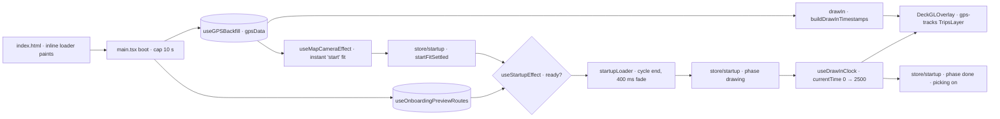
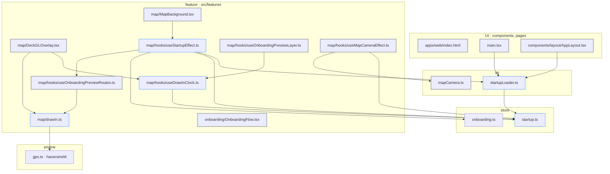
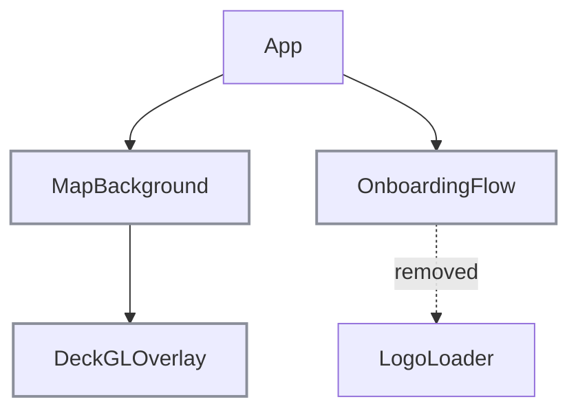

# Startup loader: tech

## Data flow



## Modules



## Components



## Files

### New

- `apps/web/src/lib/startupLoader.ts`: hand-off at the cycle end, 10 s cap, removal, skip check, `handoffDelayMs`
- `apps/web/src/store/startup.ts`: phase store (loading, drawing, done), cap, start fit settled
- `apps/web/src/features/map/hooks/useStartupEffect.ts`: ready → hand-off → draw-in; first tracks into an empty library
- `apps/web/src/features/map/hooks/useDrawInClock.ts`: `currentTime` while drawing
- `apps/web/src/features/map/drawIn.ts`: ground-speed timestamps, onboarding passes
- `apps/web/tests/features/map/drawIn.spec.ts`: timing tests
- `apps/web/tests/lib/startupLoader.spec.ts`: `handoffDelayMs` tests

### Changed

- `apps/web/index.html`: inline loader, styles, keyframes, skip script
- `apps/web/src/main.tsx`: start the cap, remove the loader on a boot error and in the root boundary
- `apps/web/src/components/layout/AppLayout.tsx`: remove the loader in the map boundary
- `apps/web/src/features/map/MapBackground.tsx`: mount `useStartupEffect`, drop the `mapLoaded` pass-through
- `apps/web/src/features/map/DeckGLOverlay.tsx`: `gps-tracks` as `TripsLayer`, drop the `mapLoaded` prop
- `apps/web/src/features/map/hooks/useOnboardingPreviewLayer.ts`: `TripsLayer` on the shared clock
- `apps/web/src/features/map/hooks/useOnboardingPreviewRoutes.ts`: builds from `drawIn.ts`
- `apps/web/src/features/map/hooks/useMapCameraEffect.ts`: `'start'` fit with `duration: 0`, no `load` gate, `settleStartFit()`
- `apps/web/src/lib/mapCamera.ts`: `'start'` fit kind, `libraryEmpty` resets `initialDone`
- `apps/web/e2e/map.spec.ts`: loader and draw-in scenes with `withStartup`
- `apps/web/e2e/helpers/onboarding.ts`: loader timeout removed
- `tools/docs/banner/capture.ts`: skip flag
- `apps/web/CLAUDE.md`: geo-layers in the stack row
- `pnpm-lock.yaml`: geo-layers and its peers
- `apps/web/src/features/onboarding/OnboardingFlow.tsx`: drop `LogoLoader`
- `apps/web/src/features/onboarding/LogoLoader.tsx`: deleted
- `apps/web/src/features/map/previewDrawIn.ts`: deleted
- `apps/web/tests/features/map/previewDrawIn.spec.ts`: deleted
- `apps/web/tests/lib/mapCamera.spec.ts`: `'start'` fit cases, `:134` flips, filter-to-0 case
- `apps/web/package.json`: `@deck.gl/geo-layers`, `@deck.gl/extensions`, `@deck.gl/mesh-layers` at `~9.2.9`
- `apps/web/e2e/helpers/test.ts`: skip flag
- `tools/workbench/shared/capture.ts`: `withStartup` opt-out
- `packages/ui/src/theme.css`: L3 keyframes removed
- `packages/i18n/messages/en.json`: `ui_onboarding_loading` removed
- `packages/i18n/messages/de.json`: `ui_onboarding_loading` removed

## Interfaces

```ts
// apps/web/src/lib/startupLoader.ts
export const STARTUP_LOADER_CYCLE_MS = 1500;
export const STARTUP_LOADER_CAP_MS = 10_000;
export const handoffDelayMs: (elapsedMs: number, cycleMs: number) => number;
export const handOffStartupLoader: () => Promise<void>;
export const startStartupLoaderCap: () => void;
export const removeStartupLoader: () => void;
export const startupLoaderSkipped: () => boolean;

// apps/web/src/store/startup.ts
export interface StartupState {
  phase: 'loading' | 'drawing' | 'done';
  drawInStartedAt: number | null;
  capped: boolean;
  startFitSettled: boolean;
  startTrackDrawIn: () => void;
  finishTrackDrawIn: () => void;
  skipTrackDrawIn: () => void;
  capStartupLoader: () => void;
  settleStartFit: () => void;
}
export const useStartupStore: UseBoundStore<StoreApi<StartupState>>;

// apps/web/src/features/map/drawIn.ts
export const DRAW_IN_END_MS = 2500;
export const buildDrawInTimestamps: (paths: [number, number][][], seed: number) => number[][];
export const buildPreviewPasses: (routes: PreviewRoute[]) => PreviewPasses;

// apps/web/src/features/map/hooks/useDrawInClock.ts
export const useDrawInClock: () => number;

// apps/web/src/features/map/hooks/useStartupEffect.ts
export const useStartupEffect: (gpsData: SessionGPS[] | null) => void;

// apps/web/src/lib/mapCamera.ts
export type MapCameraFit = 'start' | 'overview' | 'session' | 'lap' | 'lapClose' | 'trip' | 'studio';
// MapCameraObservation gains: libraryEmpty: boolean;

// tools/workbench/shared/capture.ts
export const withStartup: (page: Page) => Promise<void>;
```
