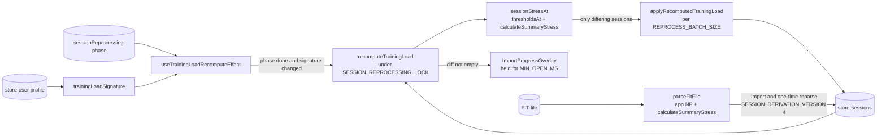
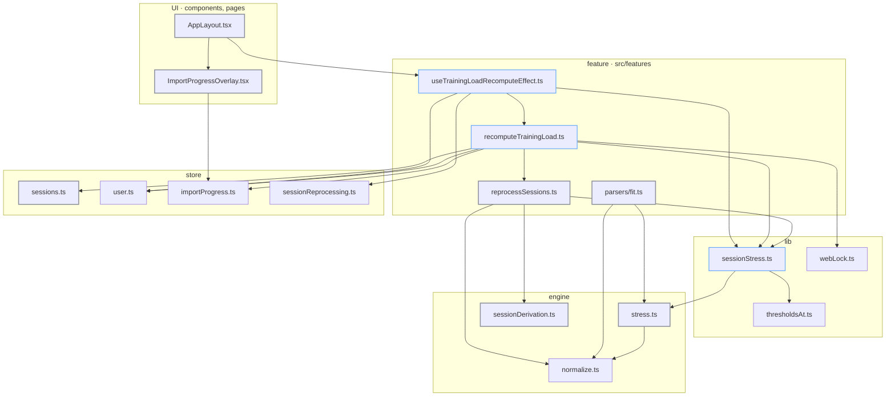
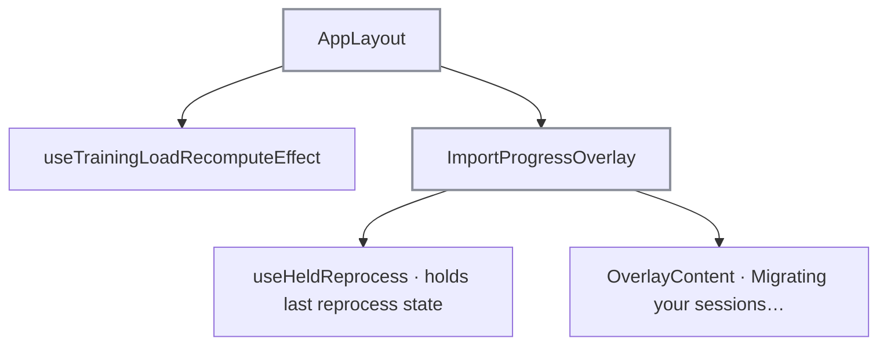

# Training load recompute: tech

## Data flow



## Modules



### New

- `src/lib/sessionStress.ts`: session + profile → stored load; profile signature for the effect
- `src/features/sessions/recomputeTrainingLoad.ts`: metadata-only recompute under the reprocessing lock
- `src/features/sessions/hooks/useTrainingLoadRecomputeEffect.ts`: runs the recompute on signature change once reprocessing is done

### Changed

- `src/packages/engine/stress.ts`: `calculateSummaryStress`, `calculateTSS` takes NP, `calculateSessionStress` always returns derived NP
- `src/packages/engine/sessionDerivation.ts`: `SESSION_DERIVATION_VERSION` bumped to 4
- `src/parsers/fit.ts`: app NP from records for every session, load via `calculateSummaryStress`
- `src/features/sessions/reprocessSessions.ts`: lock exported, keep rule removed, stress via `sessionStressAt`
- `src/store/sessions.ts`: `applyRecomputedTrainingLoad` action
- `src/components/layout/AppLayout.tsx`: mounts `useTrainingLoadRecomputeEffect`
- `src/components/ui/ImportProgressOverlay.tsx`: `MIN_OPEN_MS` 1500, reprocess overlay held until `openedAt + MIN_OPEN_MS`
- `messages/en.json`: `ui_reprocess_updating` "Migrating your sessions…"
- `messages/de.json`: `ui_reprocess_updating` "Einheiten werden migriert…"

## Interfaces

```ts
// src/packages/engine/stress.ts
export interface StressSummary {
  durationSec: number;
  avgHr?: number;
  normalizedPower?: number;
}
export interface StressThresholds {
  restHr: number;
  maxHr: number;
  gender: Gender;
  ftp?: number;
}
export interface SessionStress {
  tss: number;
  stressMethod: 'tss' | 'trimp' | 'duration';
  normalizedPower?: number;
}
export const calculateSummaryStress: (
  summary: StressSummary,
  thresholds: StressThresholds,
) => SessionStress;
export const calculateSessionStress: (
  records: SessionRecord[],
  durationSec: number,
  avgHr: number | undefined,
  restHr: number,
  maxHr: number,
  gender: Gender,
  ftp?: number,
) => SessionStress;
```

```ts
// src/lib/sessionStress.ts
export type StoredSessionStress = Pick<TrainingSession, 'tss' | 'stressMethod' | 'normalizedPower'>;
type StressInputs = Pick<TrainingSession, 'date' | 'duration' | 'avgHr' | 'normalizedPower'>;
export const sessionStressAt: (session: StressInputs, profile: UserProfile) => StoredSessionStress;
export const trainingLoadSignature: (profile: UserProfile | null) => string;
```

```ts
// src/features/sessions/recomputeTrainingLoad.ts
export const recomputeTrainingLoad: () => Promise<number>;
```

```ts
// src/features/sessions/hooks/useTrainingLoadRecomputeEffect.ts
export const useTrainingLoadRecomputeEffect: () => void;
```

```ts
// src/features/sessions/reprocessSessions.ts
export const SESSION_REPROCESSING_LOCK = 'pacevault-session-reprocessing';
```

```ts
// src/store/sessions.ts
export type RecomputedTrainingLoad = Pick<
  TrainingSession,
  'id' | 'tss' | 'stressMethod' | 'normalizedPower'
>;
interface SessionsState {
  applyRecomputedTrainingLoad: (changes: RecomputedTrainingLoad[]) => void;
}
```

```ts
// src/packages/engine/sessionDerivation.ts
export const SESSION_DERIVATION_VERSION = 4;
```

## Components


