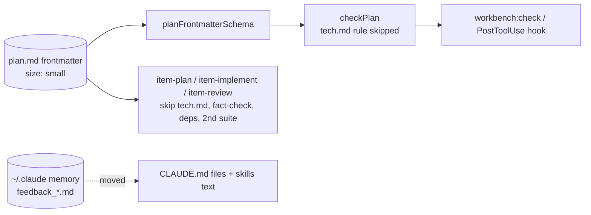
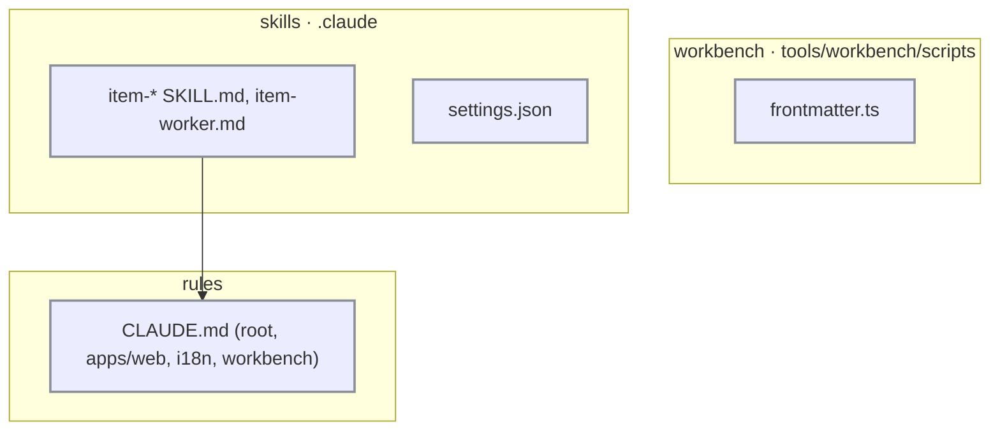

# Workbench flow: tech

## Data flow



## Modules



## Files

### New

### Changed

- `tools/workbench/scripts/frontmatter.ts`: optional `size: small`; `checkPlan` skips the tech.md rule for it
- `tools/workbench/tests/frontmatter.spec.ts`: size cases
- `tools/workbench/scripts/statusGuard.ts`: `size:` owner-only
- `tools/workbench/tests/statusGuard.spec.ts`: size guard cases
- `tools/workbench/tests/boardRead.spec.ts`: small item read and checked
- `tools/workbench/site/src/app/ItemCard.tsx`: tinted, outlined card for `size: small`
- `.claude/skills/item-backlog/SKILL.md`: `size: small`; tags removed
- `.claude/skills/item-explore/SKILL.md`: tags removed
- `.claude/skills/item-plan/SKILL.md`: small path; tags removed
- `.claude/skills/item-implement/SKILL.md`: small path; tags removed
- `.claude/skills/item-review/SKILL.md`: small review doc; tags removed
- `.claude/skills/item-done/SKILL.md`: tags removed
- `.claude/agents/item-worker.md`: tags removed
- `.claude/settings.json`: `env.CLAUDE_CODE_EFFORT_LEVEL`
- `CLAUDE.md`: §5 e2e, vp, gh lines
- `apps/web/CLAUDE.md`: UI rules
- `packages/i18n/CLAUDE.md`: tone rule
- `tools/workbench/CLAUDE.md`: one board server
- `tools/workbench/README.md`: `size:` field
- `tools/workbench/GUIDE.md`: fast lane line

## Interfaces

```ts
// tools/workbench/scripts/frontmatter.ts
export const planFrontmatterSchema: z.ZodType<{ /* … */ size?: 'small' }>;
export const checkPlan: (folder: string, plan: string, hasTech: boolean) => string[];
export const readSize: (text: string) => string | undefined;
```
