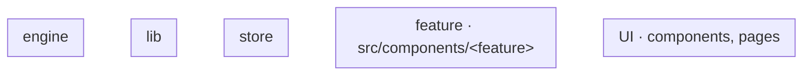
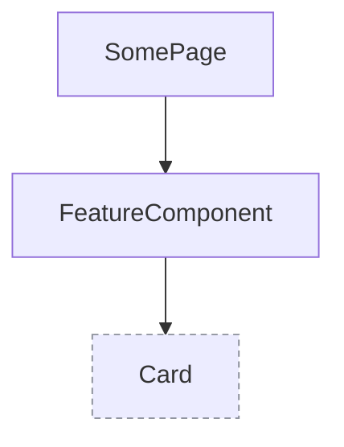

# <Item title>: tech

<!--
Copied by item-plan next to plan.md; required from status planned on (vp run workbench:check).
Sections in this order (overview first, details further down; the Tech tab shows them so); leave
out a section that does not apply. Every diagram is Mermaid.
Paths are repo-relative and exist in the code (New: created by this item, at the path it will have).
`### New` and `### Changed` under `## Files` are read by tools/workbench/scripts/frontmatter.ts
(readTechPaths; older tech.md files keep them under `## Modules`): one backticked path per bullet, a
short note after it is fine. A folder path ends with `/`.
Every section is the planned record and stays as planned. vp run workbench:deps -- <item> writes the
actuals to review/ (run at every review round): the import graph (the folders of the plan's areas
and of the planned TypeScript paths, focus: New and Changed) for Modules, files.json (files changed since the base vs New/Changed), interfaces.md (the
exported signatures of the changed TypeScript files, unplanned ones marked) and components.mmd (the
tree of the New/Changed .tsx files). On the Tech tab each of these sections has its own Planned | Actual switch; Data flow has no actual.
-->

## Data flow


## Modules



## Components



## Files

### New

- `apps/web/src/components/<feature>/<File>.tsx`: what it does

### Changed

- `apps/web/src/<path>.ts`: what changes

## Interfaces

```ts
// apps/web/src/<path>.ts
export const example: (input: Input) => Output;
```
