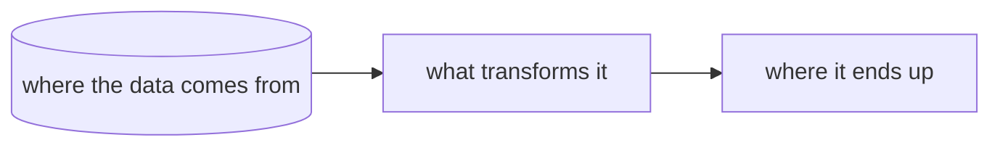
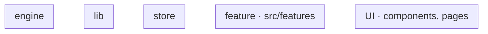
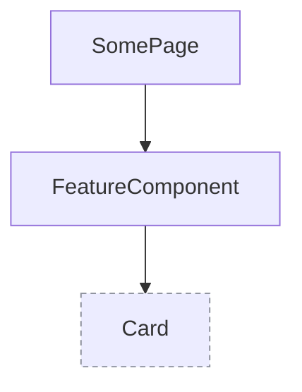

# <Item title>: tech

<!--
Copied by item-plan next to plan.md; required from status planned on (vp run workbench:check).
Sections in this order; leave out a section that does not apply. Every diagram is Mermaid.
Paths are repo-relative and exist in the code (New: created by this item, at the path it will have).
`### New` and `### Changed` are read by tools/workbench/scripts/frontmatter.ts (readTechPaths): one
backticked path per bullet, a short note after it is fine. A folder path ends with `/`.
vp run workbench:deps -- <item> takes New (or Changed when New is empty) as the focus of the
actual import graph and compares both lists with what the code imports.
-->

## Data flow



## Modules



### New

- `apps/web/src/features/<feature>/<File>.tsx`: what it does

### Changed

- `apps/web/src/<path>.ts`: what changes

## Interfaces

```ts
// apps/web/src/<path>.ts
export const example: (input: Input) => Output;
```

## Components


