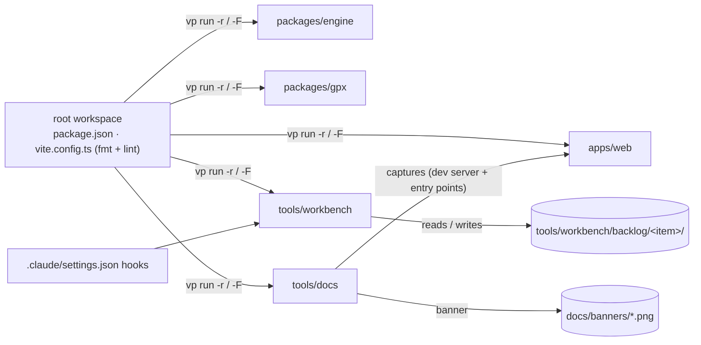
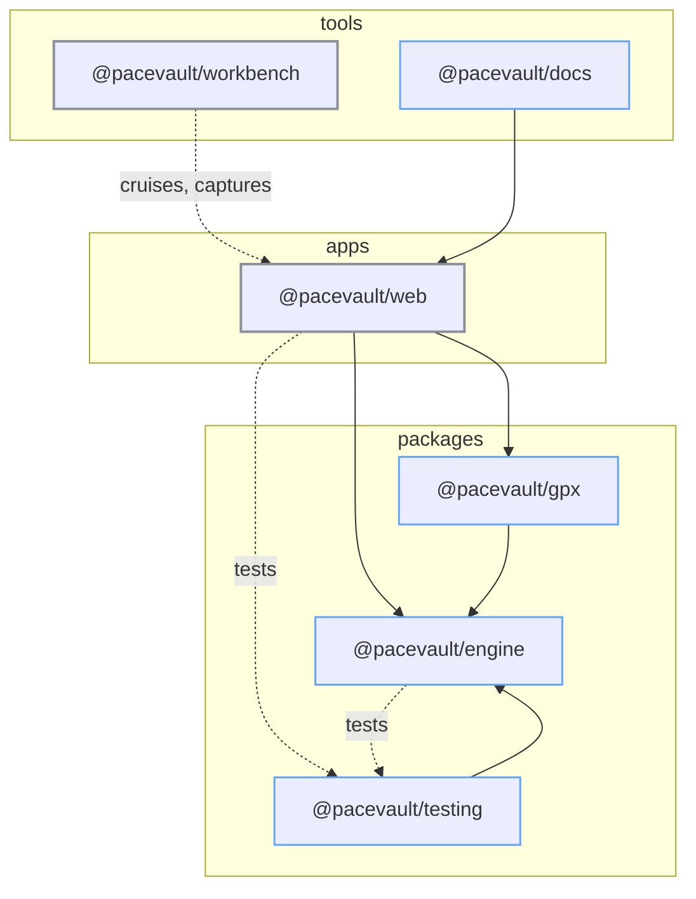

# Repo restructure: tech

## Data flow



## Modules



### New

- `apps/web/package.json`: app manifest (deps and scripts from the root), test entry-point exports for tools/docs
- `apps/web/vite.config.ts`: app part of today's `vite.config.ts`
- `apps/web/README.md`: app README
- `apps/web/CLAUDE.md`: app rules split from the root
- `packages/engine/package.json`: `@pacevault/engine`, exports the sources
- `packages/engine/vitest.config.ts`: node env
- `packages/engine/README.md`: package README
- `packages/gpx/package.json`: `@pacevault/gpx`, depends on engine
- `packages/gpx/vitest.config.ts`: jsdom (DOMParser)
- `packages/gpx/README.md`: package README
- `packages/gpx/CLAUDE.md`: pure-package rules
- `packages/gpx/tests/fixtures/route.gpx`: copy of the e2e fixture
- `packages/testing/package.json`: `@pacevault/testing`, test factories (records, gps, sessions)
- `packages/testing/README.md`: package README
- `packages/testing/CLAUDE.md`: package rules
- `tools/workbench/package.json`: from `workbench/site/package.json`
- `tools/workbench/vitest.config.ts`: tests for scripts and hooks
- `tools/workbench/.dependency-cruiser.cjs`: moved from the root, rules for the new paths
- `tools/workbench/CLAUDE.md`: board and scripts conventions
- `tools/docs/package.json`: `@pacevault/docs`, depends on `@pacevault/web`
- `tools/docs/vite.config.ts`: serves the banner page (React, Tailwind, `@` alias)
- `tools/docs/README.md`: package README
- `tools/docs/CLAUDE.md`: what the docs tool produces and how to run it

### Changed

- `package.json`: workspace manifest with fan-out scripts
- `pnpm-workspace.yaml`: `apps/*`, `packages/*`, `tools/*`
- `vite.config.ts`: only `fmt` and `lint`
- `tsconfig.json`: references to every package
- `.gitignore`: new paths
- `.claude/settings.json`: hook commands point at `tools/workbench/scripts/`
- `.github/workflows/ci.yml`: filtered runs
- `.github/workflows/deploy.yml`: same, plus `entryPoint: apps/web`
- `src/features/settings/AboutSection.tsx`: SOURCES.md link
- `CLAUDE.md`: repo map, shared rules, links
- `README.md`: banner section, SOURCES link, drift fixes
- `.claude/agents/feature-worker.md`: paths
- `.claude/skills/`: paths in every feature skill

## Interfaces

```jsonc
// packages/engine/package.json
{ "name": "@pacevault/engine", "type": "module", "exports": { "./*": "./src/*" } }
```

```jsonc
// apps/web/package.json (entry points for tools/docs only)
{
  "exports": {
    "./demo/schedule": "./src/features/demo/demoSchedule.ts",
    "./store/layout": "./src/store/layout.ts",
    "./e2e/openMeteo": "./e2e/helpers/openMeteo.ts",
  },
}
```
