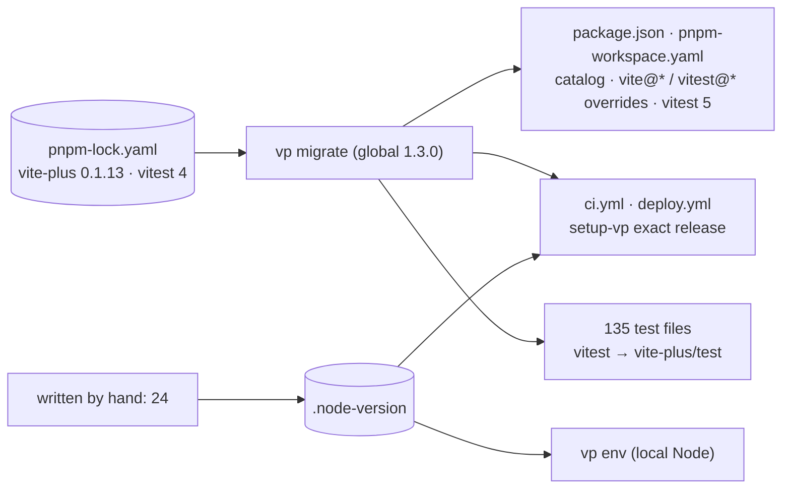
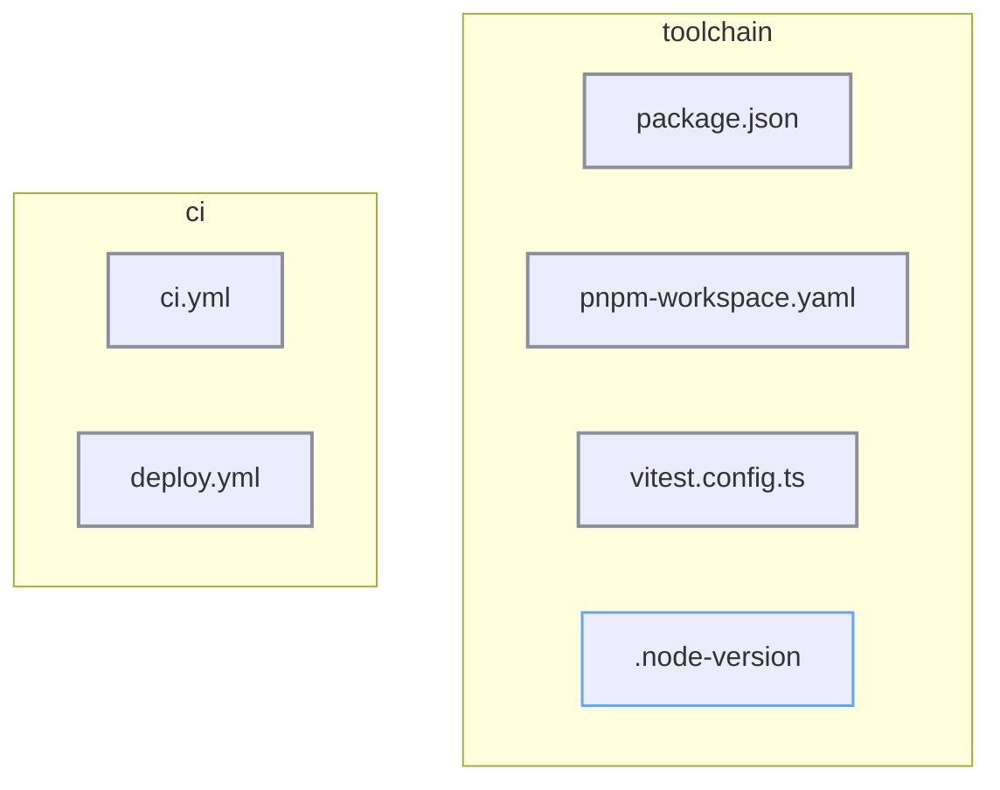

# vite-plus upgrade: tech

## Data flow



## Modules



### New

- `.node-version`: `24`, written by hand

### Changed

- `package.json`: `catalog:` references, vite-plus, vitest, coverage plugin
- `pnpm-workspace.yaml`: `vite@*` / `vitest@*` overrides, `catalog:` block
- `.gitignore`: `.vitest/`
- `tests/`: `vitest` imports rewritten to `vite-plus/test` (Q5)
- `tests/CLAUDE.md`: import convention
- `pnpm-lock.yaml`: refreshed
- `vitest.config.ts`: import from `vite-plus`, compatibility setting added then removed
- `.github/workflows/ci.yml`: setup-vp exact release, `node-version-file`
- `.github/workflows/deploy.yml`: same
- `CLAUDE.md`: tech stack row
- `README.md`: contributing (Node via vp)

## Interfaces

```yaml
# .github/workflows/ci.yml
- uses: voidzero-dev/setup-vp@v1.21.2
  with:
    node-version-file: .node-version
```
